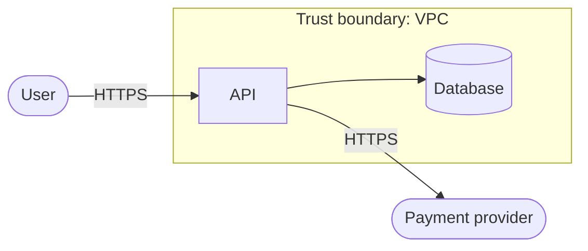

# Threat modeling

> **Precedence:** a project security policy that is *stricter* than this file wins. A weaker one
> needs a documented risk acceptance (an ADR or ticket with an owner).

Threat modeling finds design flaws while they are cheap to fix (OWASP A06). It answers four
questions (the Threat Modeling Manifesto): **What are we working on? What can go wrong? What
are we going to do about it? Did we do a good enough job?** A one-hour model of a feature
beats a week of patching after release.

## When it is required

Do a threat model (even a short one) when the change:

- adds a **new service, component or data store**;
- changes **authentication, authorization or session handling**;
- adds a **new source of external input** (public endpoint, webhook, file upload, message queue);
- crosses a **trust boundary** (new third-party integration, new network zone, multi-tenancy);
- stores or processes **PII, credentials, payments or other sensitive data**;
- changes **how secrets or keys** are handled.

For other changes, a one-line check ("no new inputs, trust boundaries or sensitive data") in the
PR is enough. Scale the model to the risk: a bug fix needs none.

## Process

1. **Scope and assets.** List what's being built and what an attacker would want (data, money,
   access, availability, reputation).
2. **Data-flow diagram.** Draw external entities, processes, data stores and flows, and draw the
   **trust boundaries** (internet ↔ app, app ↔ database, tenant ↔ tenant, your code ↔ third party).
   Use Mermaid so the diagram lives with the code.
3. **Identify threats with STRIDE** on every element and every flow that crosses a boundary.
4. **Rate and decide.** For each threat: likelihood × impact (Low / Medium / High). Choose: mitigate,
   transfer, accept (with an owner), or eliminate (remove the feature).
5. **Record mitigations as work.** Each becomes a requirement, a task or a test, linked to the PR.
6. **Revisit** when the design changes, and after incidents.

## STRIDE

| Threat | Violates | Typical questions | Typical mitigations |
|---|---|---|---|
| **S**poofing | Authenticity | Can someone pretend to be a user, service or device? | Strong authN, mTLS, signed tokens (`auth-session.md`) |
| **T**ampering | Integrity | Can data be changed in transit, at rest or by the client? | TLS, signatures/HMAC, server-side validation, DB constraints |
| **R**epudiation | Non-repudiation | Can someone deny an action, and could we prove it? | Audit logs with identity and time, immutable storage |
| **I**nformation disclosure | Confidentiality | Can data leak through errors, logs, caches, side channels or over-broad queries? | Encryption, authZ per object, minimal responses, redaction |
| **D**enial of service | Availability | Can someone exhaust CPU, memory, connections, quota or money? | Rate limits, quotas, timeouts, bounded queues, autoscaling limits |
| **E**levation of privilege | Authorization | Can a low-privilege actor gain higher access? | Least privilege, deny by default, input validation, sandboxing |

## Template

Copy this into the design doc or the PR (`.claude/templates/design-doc.md` has a section for it).

````markdown
## Threat model: <feature>
**Scope:** <what is in and out>  **Assets:** <list>  **Date / owner:** <…>

### Data-flow diagram


### Threats
| # | Element / flow | STRIDE | Threat | Likelihood | Impact | Decision | Mitigation / test |
|---|---|---|---|---|---|---|---|
| 1 | user → api | S | Stolen session token replayed | M | H | Mitigate | Short TTL, rotation, device binding; test: expired token rejected |

### Residual risk and accepted items
<each with an owner and a review date>
````

## Abuse cases

Pair each use case with a misuse case: "As a user I can reset my password" → "As an attacker I
enumerate accounts through the reset form." Add the abuse case to the acceptance criteria and write a test.

## Sources

- Threat Modeling Manifesto — https://www.threatmodelingmanifesto.org/
- OWASP Threat Modeling Cheat Sheet — https://cheatsheetseries.owasp.org/cheatsheets/Threat_Modeling_Cheat_Sheet.html
- Adam Shostack, *Threat Modeling: Designing for Security* (STRIDE)
- Microsoft Threat Modeling Tool / STRIDE — https://learn.microsoft.com/en-us/azure/security/develop/threat-modeling-tool-threats
- OWASP Threat Dragon — https://owasp.org/www-project-threat-dragon/
