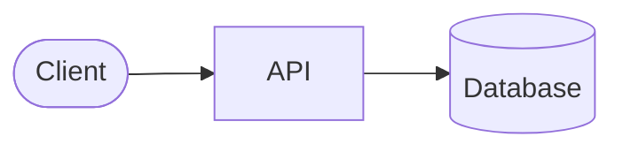

# Design: Feature or system name

- **Author:** name  **Reviewers:** names  **Status:** Draft | In review | Approved | Implemented
- **Date:** YYYY-MM-DD  **Tracking issue:** link

> Scale this to the change. A small feature needs Summary, Proposal and Test plan. A new service
> needs every section. Delete sections that don't apply instead of writing "N/A".

## 1. Summary

Two or three sentences: what we're building and why now.

## 2. Goals and non-goals

**Goals** (measurable where possible):
- ...

**Non-goals** (things a reader might assume are included, but are not):
- ...

## 3. Background and requirements

- **User stories and acceptance criteria:** link or list (Given / When / Then).
- **Non-functional requirements:** performance targets (for example p95 under 200 ms at 500 rps), availability,
  security, scale, accessibility, i18n.
- **Constraints:** deadlines, existing systems, compliance.

## 4. Proposal

How it works, in enough detail that someone else could build it.

### 4.1 Architecture

### 4.2 API contract

Endpoints or messages, request and response shapes, error model, following
`.claude/rules/core/api-design.md`. Define the contract before the implementation.

### 4.3 Data model

New or changed tables and fields, indexes, migration plan (expand, migrate, contract),
retention and data classification (`.claude/security/privacy-data.md`).

### 4.4 Key flows

Sequence diagrams for the main path and the main failure paths.

## 5. Alternatives considered

| Option | Pros | Cons | Why not |
|---|---|---|---|

## 6. Security and privacy

Threat model summary (`.claude/security/threat-modeling.md`): trust boundaries, top threats and
mitigations, authentication and authorization, personal data handled. Required for a new
service, an auth change, new external input, or personal data.

## 7. Reliability and operations

Failure modes and how they are handled, timeouts and retries, rate limits, observability
(logs, metrics, traces, alerts, SLOs), runbook, capacity.

## 8. Rollout and rollback

Feature flags, phased rollout, migration order, and the exact steps to undo it.

## 9. Test plan

Unit, integration, contract and end-to-end tests, plus the load, security and failure-injection
tests that apply. Which acceptance criteria each one covers.

## 10. Work breakdown

Small, independently shippable slices in order, each with an estimate and a "done" statement.

## 11. Open questions and risks

| Question or risk | Owner | Needed by |
|---|---|---|

## 12. Well-Architected check (new services and large changes)

One line per pillar: the evidence that it is covered, or the gap and who owns it. Questions and
the trade-offs between pillars are in `.claude/standards/well-architected.md`.

| Pillar | Covered by (evidence) or gap | Owner |
|---|---|---|
| Operational excellence | | |
| Security | | |
| Reliability | | |
| Performance efficiency | | |
| Cost optimization | | |
| Sustainability | | |
