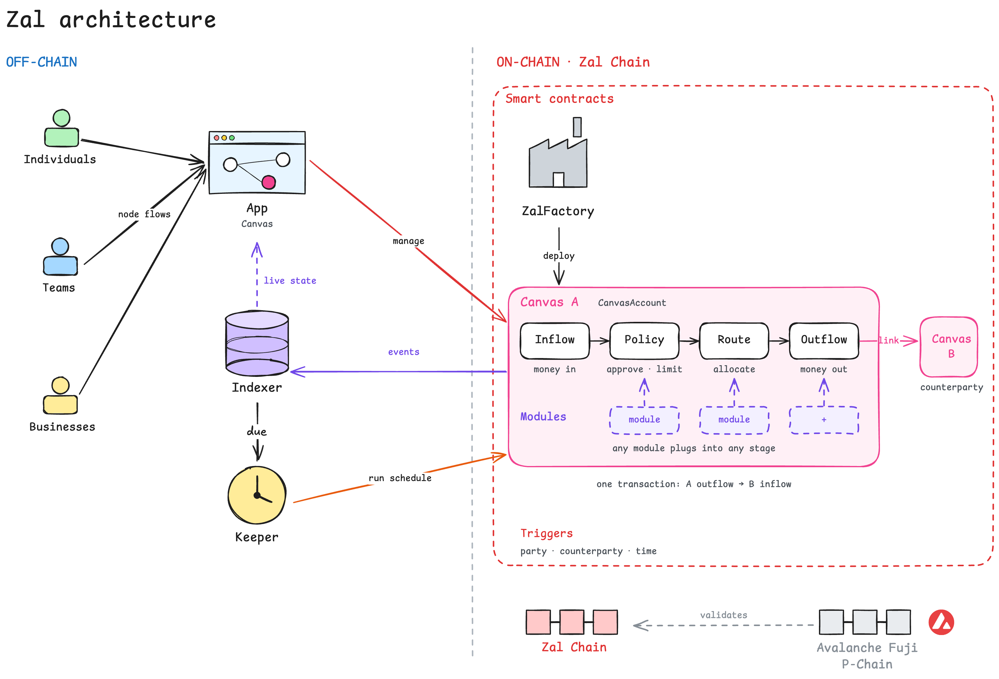
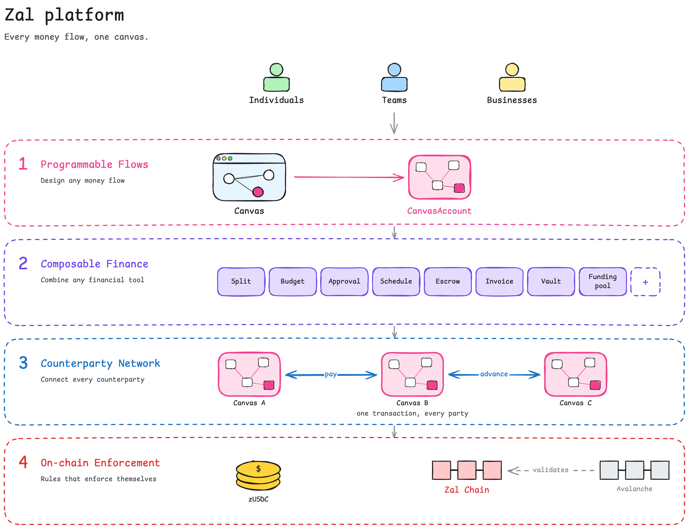
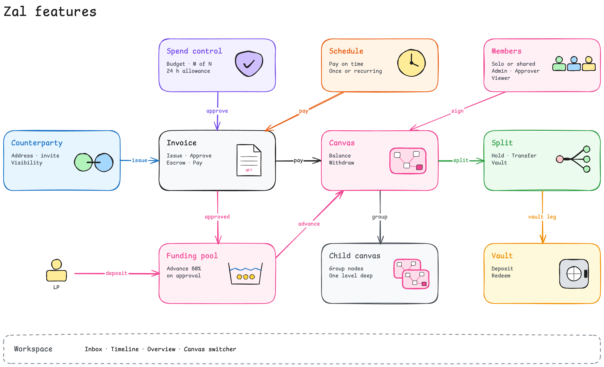

# Zal


<h3 align="center">Every money flow, one canvas.</h3>

<p align="center">Programmable payments on an Avalanche L1. For individuals, teams and businesses.</p>

## Live on testnet
| | |
|---|---|
| App | https://app.100-63-191-30.sslip.io |
| Sandbox | https://app.100-63-191-30.sslip.io/app/canvas?sandbox=1 |
| Explorer | https://app.100-63-191-30.sslip.io/app/explorer |
| API | https://api.100-63-191-30.sslip.io/v1 |

## Architecture

### System

<picture>
  <source media="(prefers-color-scheme: dark)" srcset="docs/diagrams/zal-architecture.dark.png">
  
</picture>

- Canvas: `CanvasAccount`. Inflow → Policy → Route → Outflow.
- Modules plug into any stage.
- Link: one transaction, A's outflow → B's inflow.
- Off-chain: app, indexer (read only), keeper (time trigger).

Detail: [docs/architecture](docs/architecture/README.md).

### Platform

<picture>
  <source media="(prefers-color-scheme: dark)" srcset="docs/diagrams/zal-platform.dark.png">
  
</picture>

| Pillar | |
|---|---|
| Programmable Flows | Design any money flow |
| Composable Finance | Combine any financial tool |
| Counterparty Network | Connect every counterparty, one transaction |
| On-chain Enforcement | Contracts enforce the rules |

### Features

<picture>
  <source media="(prefers-color-scheme: dark)" srcset="docs/diagrams/zal-features.dark.png">
  
</picture>

| Feature | |
|---|---|
| Canvas | One per party, same contract for all |
| Members | Solo or shared. Admin, Approver, Viewer |
| Spend control | Budget, M of N above a 24 h allowance |
| Counterparty | By address or invite link |
| Invoice | NFT. Issue, approve, escrow, pay |
| One-transaction payment | Buyer → pool → seller's Split |
| Funding pool | 80% advance on approval |
| Split | Hold, Transfer, Vault legs |
| Schedule | Timed or recurring, run by a keeper |
| Child canvas | Group nodes, one level |
| Workspace | Inbox, Timeline, Overview, canvas switcher |

Details: [product-doc.md](docs/product/product-doc.md).

## Why Avalanche

| | |
|---|---|
| Own L1 | Own chain, own fees, no shared congestion |
| EVM | Solidity, OpenZeppelin, Foundry |
| Fast finality | About a second, no reorgs |
| Interchain (planned) | ICTT path for real USDC from C-Chain |

## Network

| | |
|---|---|
| Name | Zalax Payroll Chain (Avalanche L1 on Fuji) |
| Chain ID | `102026` |
| Gas token | ZAX |
| RPC | `https://rpc.100-63-191-30.sslip.io/ext/bc/L8z3EMtv6swD96pmVRsRLgYJR6iipDf8tSDe8vVnfqbHX7rxC/rpc` |
| WebSocket | same path, ending in `/ws` |
| Blockchain ID | `L8z3EMtv6swD96pmVRsRLgYJR6iipDf8tSDe8vVnfqbHX7rxC` |
| Subnet ID | `pCbR7R4jGiJTBKkrMCLsALnNyJqYARb4GhknNGgU6f2bE8MyM` |
| Validator | `NodeID-EdNQxmA2ZQw8aCibA4V5onkEpPgvESWBE` |

## Deployment

Deployed 15 Nov 2026, block 24. Source: [deployments/l1.json](packages/contracts/deployments/l1.json).

| Contract | Address |
|---|---|
| ZalFactory | `0xb6fB0bAE55C3B10A52AbFB12a954F9AD7ce10013` |
| CanvasAccount (implementation) | `0xb67FF575307699dDACd58F581b894C9C316b1EF6` |
| RelationshipRegistry | `0x5FE372365723AAA13F59a790fB09CFC17914a191` |
| ZalInvoice | `0xf95A169Fd0A5190F3661FFd8bcdE45f229f4D972` |
| ZalFundingPool | `0xdfaE31B5d0B46595220788A81821f669f63CF11c` |
| ZalVault | `0x7fF89d37623f70987485deec28ACC7a38bd73F78` |
| ZUSDC | `0x443B9429EA87faAE61c3cCb6b10477D6993E1c30` |
| Owner | `0x9F7c870D0347989c2aB8c3a3263467874936208f` |
| Schedule keeper (gas only) | `0x5050931129c6dd089ba550354B5746a9b86Dd2f7` |
| Gas faucet | `0xc303d559a991fa0f0d6af475a57df7299dd6bedb` |

| Parameter | Value |
|---|---|
| `advanceRateBps` | 8000 (80%) |
| `annualFeeBps` | 1521 (15.21%/yr) |
| `vaultSimulatedApyBps` | 0 |
| Compiler | Solidity 0.8.25, `cancun` |

Deploy: `ZAL_NETWORK=l1 forge script script/Deploy.s.sol --rpc-url <RPC> --broadcast`. Full steps: [l1-hosting.md](docs/runbooks/l1-hosting.md).

## Stack

| | |
|---|---|
| Contracts | Solidity 0.8.25, Foundry, OpenZeppelin 5 |
| Web | Next.js 16, HeroUI v3, xyflow, wagmi, viem, tevm |
| Indexer | Ponder, Hono, PostgreSQL 17 |
| Keeper | Node.js, viem |
| Ops | pnpm, Docker Compose, Caddy |

## Run locally

```bash
git clone --recurse-submodules <repo-url> zal && cd zal
docker compose up -d --build --wait
```

Web http://localhost:3100 · RPC `http://localhost:8545` · chain `31337`. More: [local-stack.md](docs/runbooks/local-stack.md).

Sandbox only: `pnpm install && pnpm --filter @zal/web dev`.

## Repository

| Path | |
|---|---|
| [packages/contracts](packages/contracts) | Contracts, tests |
| [packages/web](packages/web) | App, explorer, sandbox |
| [packages/indexer](packages/indexer) | Indexer, `/v1` API |
| [packages/keeper](packages/keeper) | Schedule runner |
| [deploy/l1](deploy/l1) | Production stack, `redeploy.sh` |
| [docs](docs) | Product, architecture, runbooks |

## Docs

[One-pager](docs/product/one-pager.md) · [Product doc](docs/product/product-doc.md) · [PRD](docs/product/prd.md) · [Architecture](docs/architecture/README.md) · [Runbooks](docs/runbooks) · [AGENTS.md](AGENTS.md)
