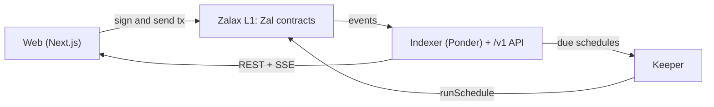

# Zal

**Manage every flow of your team's money on one canvas.**

Zal is an on-chain payment canvas on its own Avalanche L1. Every party gets the same canvas and draws where money goes with nodes and edges. A seller issues invoices, a buyer approves and pays them in one transaction through both parties' rules, and a funding pool advances 80% to the seller as soon as the buyer approves.

Testnet only: zUSDC has no real value and Vault yield is simulated.

| | |
|---|---|
| App | https://app.100-63-191-30.sslip.io |
| Sandbox (no wallet needed) | https://app.100-63-191-30.sslip.io/app/canvas?sandbox=1 |
| Explorer | https://app.100-63-191-30.sslip.io/app/explorer |
| Chain | Zalax L1 on Fuji, chain id `102026`, gas token ZAX. RPC in [l1-hosting.md](docs/runbooks/l1-hosting.md) |

## What it does

| Feature | What you get |
|---|---|
| Canvas | One view of every money flow. Each party is the same `CanvasAccount` contract |
| Relationships | Add a counterparty by address or invite link. Buyer and Seller are roles on the link, not on the account |
| Invoices | Issued as NFTs. The buyer approves against a Budget, escrows, then pays |
| Approval policy | M of N signatures above a single-signature limit per 24 h |
| Split | Every incoming payment divides itself into up to 8 legs: Hold, Transfer, Vault |
| One-transaction payment | Buyer, then the Funding pool if advanced, then the seller's Split, in one transaction |
| Advance | 80% of face value as soon as the invoice is approved, from a Funding pool fed by liquidity providers |
| Schedules | Pay an invoice or transfer money at set times. A keeper runs them |
| Inbox, Timeline, Overview | What needs you, what happened, and where the money is |

Full feature list, user stories and glossary: [docs/product/product-doc.md](docs/product/product-doc.md).

## How it works



- **Contracts** hold every rule and every balance. The UI derives each node's state from the chain, never from client state.
- **Indexer** turns contract events into a read API and pushes changes over SSE, so both canvases update within seconds.
- **Keeper** runs due schedules. It pays gas only and holds no authority over funds.
- **Sandbox** runs the same contract bytecode in the browser, with bots as counterparties and a movable clock.

## Tech stack

| Layer | Stack |
|---|---|
| Contracts | Solidity 0.8.25, Foundry, OpenZeppelin 5 |
| Chain | Avalanche L1 (Subnet-EVM) on Fuji |
| Web | Next.js 16, React 19, HeroUI v3, xyflow, wagmi, viem, TanStack Query, tevm (sandbox) |
| Indexer | Ponder, Hono, PostgreSQL 17, SSE |
| Keeper | Node.js, viem |
| Ops | pnpm workspaces, Docker Compose, Caddy |

## Run it locally

Needs Docker with Compose v2, Node 24 and pnpm.

```bash
git clone --recurse-submodules <repo-url> zal && cd zal
docker compose up -d --build --wait
```

Open http://localhost:3100. The stack runs Postgres, anvil (chain 31337), the contract deploy, the indexer, the keeper and the web app. To use a wallet, add a network with RPC `http://localhost:8545` and chain id `31337`, then mint zUSDC from **Deposit**. Details and ports: [local-stack.md](docs/runbooks/local-stack.md).

Without Docker, try the Sandbox: `pnpm install && pnpm --filter @zal/web dev`, then open `/app/canvas?sandbox=1`.

## Repository

| Path | What | Common commands |
|---|---|---|
| [packages/contracts](packages/contracts) | Smart contracts and tests | `pnpm --filter @zal/contracts build`, `test` |
| [packages/web](packages/web) | Landing, canvas app, explorer, sandbox | `pnpm --filter @zal/web dev`, `test`, `lint`, `typecheck` |
| [packages/indexer](packages/indexer) | Ponder indexer and `/v1` API | `pnpm --filter @zal/indexer test` |
| [packages/keeper](packages/keeper) | Schedule runner | `pnpm --filter @zal/keeper test` |
| [deploy/l1](deploy/l1) | Production compose, Caddy, redeploy script | `deploy/l1/redeploy.sh` |
| [docs](docs) | Product, architecture, runbooks | n/a |

After any contract ABI change, run `forge build`, then `pnpm --filter @zal/web gen:contracts`.

## Documentation

| Read | For |
|---|---|
| [One-pager](docs/product/one-pager.md) | Zal in two minutes |
| [Product document](docs/product/product-doc.md) | Positioning, personas, features, glossary |
| [PRD](docs/product/prd.md) | User stories and acceptance criteria |
| [Architecture](docs/architecture/README.md) | Contracts, requirements, system design |
| [Runbooks](docs/runbooks) | Running the local stack and the L1 host |
| [AGENTS.md](AGENTS.md) | Rules for contributors and coding agents |
