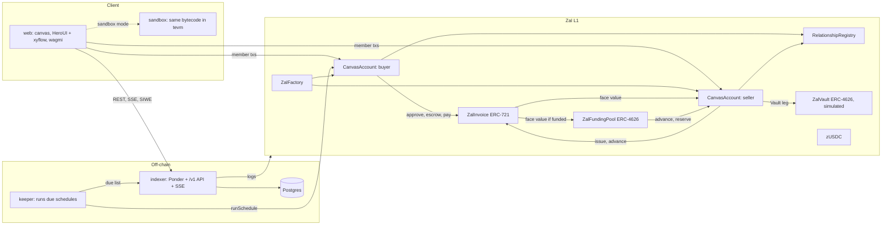

# Zal architecture

Zal is a payment canvas on an Avalanche L1 (Zalax L1, chain id 102026). Each canvas is a `CanvasAccount` contract. Two accounts form a buyer and seller relationship. The seller issues Invoice NFTs, and the buyer approves, escrows and pays them in one transaction that runs through the seller's Split. A funding pool advances money against approved invoices (reverse factoring). Payments can also be scheduled on-chain and run by a permissionless keeper. Product intent is in [../product/prd.md](../product/prd.md).

## Read in this order
1. [srd.md](srd.md): System Requirements Document. Components, contract interfaces, state machines, sequences, data, API, security, deployment, verification and traceability
2. [contracts.md](contracts.md): contract set, data shapes, state machine, settlement, pool math
3. [requirements.md](requirements.md): `ZR-*` requirements, invariants, acceptance tests
4. [decisions/](decisions/): why each choice was made (ADRs)
5. [open-questions.md](open-questions.md): TBDs and known issues

Operations: [../runbooks/local-stack.md](../runbooks/local-stack.md) (docker stack on one machine), [../runbooks/l1-hosting.md](../runbooks/l1-hosting.md) (the L1 host). Plan history: [../plans/backend.md](../plans/backend.md).

## System diagram

## Packages
| Package | Status | What |
|---|---|---|
| `packages/contracts` | built, audited 14 Nov 2026, deployed to the L1 on 15 Nov 2026 | Foundry. The spec is [contracts.md](contracts.md). `pnpm --filter @zal/contracts mutate` reruns the mutation check |
| `packages/web` | built | Next.js 16, HeroUI v3, xyflow. Rules in `packages/web/AGENTS.md` |
| sandbox (in `packages/web`) | built, ADR 0007 | The real contracts in an in-browser EVM behind a transport switch, seeded with bot counterparties and a keeper bot |
| `packages/indexer` | built, ADR 0012 | Ponder indexes every contract event into Postgres, serves the `/v1` REST API, pushes changes over SSE (Postgres `LISTEN/NOTIFY`), stores layout, read state and invites, handles SIWE sign-in and the gas faucet |
| `packages/keeper` | built, ADR 0015 | Reads due schedules from the indexer and sends `runSchedule` from a gas-only wallet. HTTP is `GET /health` and `GET /status` only |

## ADRs
| ADR | Topic | Status |
|---|---|---|
| [0001](decisions/0001-pnpm-monorepo.md) | pnpm monorepo | accepted |
| [0002](decisions/0002-one-account-contract-per-canvas.md) | One `CanvasAccount` per canvas, roles on relationships | accepted |
| [0003](decisions/0003-ghost-and-solid-map-to-chain-state.md) | Ghost and solid from chain state; drafts in layout | accepted |
| [0004](decisions/0004-early-payment-and-timeline-replay.md) | Early payment, timeline replay | accepted |
| [0005](decisions/0005-buyer-approval-pays-the-nft-holder.md) | Buyer pays the NFT holder | accepted |
| [0006](decisions/0006-heroui-cli-and-default-look.md) | HeroUI CLI and default look | accepted |
| [0007](decisions/0007-sandbox-runs-real-bytecode-in-browser.md) | Sandbox runs the real bytecode | accepted |
| [0008](decisions/0008-realtime-from-contract-events.md) | Real time from contract events | accepted; transport now SSE (ADR 0012) |
| [0009](decisions/0009-pool-underwrites-the-buyer.md) | Pool advances only against escrow or an enrolled buyer | accepted |
| [0010](decisions/0010-schedule-is-a-keeper-job.md) | Schedule as an off-chain keeper job | superseded by 0015 |
| [0011](decisions/0011-child-canvas-and-gates.md) | Child canvases and gates | accepted |
| [0012](decisions/0012-indexer-and-api.md) | Ponder indexer, Postgres, SSE | accepted |
| [0013](decisions/0013-bridge-outside-payments.md) | Bridging outside the payment flow | accepted |
| [0014](decisions/0014-layout-writes-need-approver.md) | Layout writes need Approver | accepted |
| [0015](decisions/0015-on-chain-schedules-and-keeper.md) | On-chain schedules, permissionless keeper | accepted |
| [0016](decisions/0016-rolling-daily-approval-limit.md) | Rolling 24 h approval limit | accepted |

## Off-chain state
Only presentation lives off-chain: node positions, child canvases and drafts on each canvas, display names, the effect of the "public or private" endpoint flag, notification read state, and unredeemed invite links. In live mode the indexer stores them in the `zal_app` schema; in the sandbox they stay in browser storage. Anything that moves or commits money is on-chain, including scheduled payments (ADR 0015).
