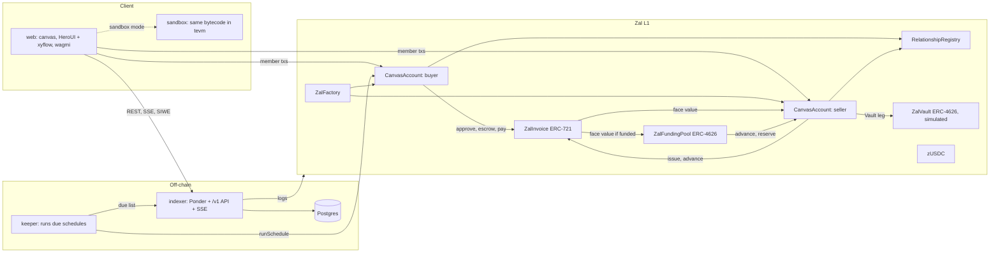

# Zal architecture

Zal is a payment canvas on an Avalanche L1 (Zalax L1, chain id 102026). Each canvas is a `CanvasAccount` contract. Two accounts form a buyer and seller relationship. The seller issues Invoice NFTs, and the buyer approves, escrows and pays them in one transaction that runs through the seller's Split. A funding pool advances money against approved invoices (reverse factoring). Payments can also be scheduled on-chain and run by a permissionless keeper. Product intent is in [../product/prd.md](../product/prd.md).

## Read in this order
1. [srd.md](srd.md): System Requirements Document. Components, contract interfaces, state machines, sequences, data, API, security, deployment, verification and traceability
2. [contracts.md](contracts.md): contract set, data shapes, state machine, settlement, pool math
3. [requirements.md](requirements.md): `ZR-*` requirements, invariants, acceptance tests
4. [open-questions.md](open-questions.md): TBDs and known issues

Operations: [../runbooks/local-stack.md](../runbooks/local-stack.md) (docker stack on one machine), [../runbooks/l1-hosting.md](../runbooks/l1-hosting.md) (the L1 host).

## System diagram

## Packages
| Package | Status | What |
|---|---|---|
| `packages/contracts` | built, audited 14 Nov 2026, deployed to the L1 on 15 Nov 2026 | Foundry. The spec is [contracts.md](contracts.md). `pnpm --filter @zal/contracts mutate` reruns the mutation check |
| `packages/web` | built | Next.js 16, HeroUI v3, xyflow. Rules in `packages/web/AGENTS.md` |
| sandbox (in `packages/web`) | built | The real contracts in an in-browser EVM behind a transport switch, seeded with bot counterparties and a keeper bot |
| `packages/indexer` | built | Ponder indexes every contract event into Postgres, serves the `/v1` REST API, pushes changes over SSE (Postgres `LISTEN/NOTIFY`), stores layout, read state and invites, handles SIWE sign-in and the gas faucet |
| `packages/keeper` | built | Reads due schedules from the indexer and sends `runSchedule` from a gas-only wallet. HTTP is `GET /health` and `GET /status` only |

## Off-chain state
Only presentation lives off-chain: node positions, child canvases and drafts on each canvas, display names, the effect of the "public or private" endpoint flag, notification read state, and unredeemed invite links. In live mode the indexer stores them in the `zal_app` schema; in the sandbox they stay in browser storage. Anything that moves or commits money is on-chain, including scheduled payments.
