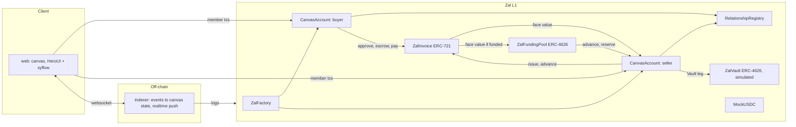

# Zal architecture

Zal is a payment canvas on an Avalanche L1. Each canvas is a `CanvasAccount` contract. Two accounts form a buyer and seller relationship. The seller issues Invoice NFTs, and the buyer approves, escrows and pays them in one transaction that runs through the seller's Split. A funding pool advances money against approved invoices (reverse factoring). Product intent is in [../product/prd.md](../product/prd.md).

## Read in this order
1. [contracts.md](contracts.md): contract set, data shapes, state machine, settlement, pool math
2. [requirements.md](requirements.md): `ZR-*` requirements, invariants, acceptance tests
3. [decisions/](decisions/): why each choice was made (ADRs)
4. [open-questions.md](open-questions.md): TBDs and known issues

## System diagram

## Packages
| Package | Status | What |
|---|---|---|
| `packages/contracts` | built, audited 14 Nov 2026 | Foundry. The spec is [contracts.md](contracts.md). `pnpm --filter @zal/contracts mutate` reruns the mutation check |
| `packages/web` | built | Next.js 16, HeroUI v3, xyflow. Rules in `packages/web/AGENTS.md` |
| sandbox (in `packages/web`) | accepted, ADR 0007 | The real contracts in an in-browser EVM behind a transport switch, seeded with bot counterparties |
| `packages/indexer` | planned | Reads contract events, derives both canvases (ghost or solid), pushes changes over a websocket, stores canvas layout. Contracts emit everything it needs (ZR-SYS-02) |

## Off-chain state
Only presentation lives off-chain: node positions on each canvas, display names, the "public or private" endpoint flag, and unredeemed invite links. Anything that moves or commits money is on-chain.
