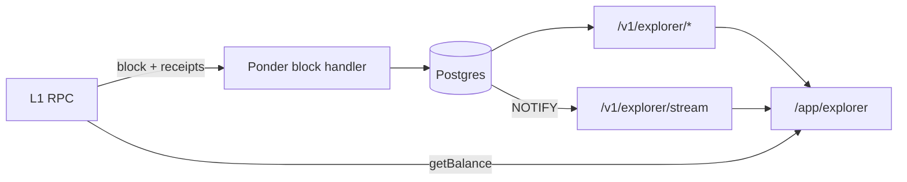

# Plan: Zal explorer

A block explorer inside the web app for the Zal L1 (chain 102026). The Avalanche Builder Hub explorer shows no history for this chain, because the Avalanche Data API does not index it (`Chain config not found for chain ID: 102026`).

## Decisions
| Topic | Decision |
|---|---|
| Access | Public. No wallet is needed to browse or search |
| Network | Always the live L1, through the indexer. In sandbox mode the explorer still shows the L1, with a "live L1" chip |
| Data source | Ponder `blocks` source (interval 1) in `packages/indexer`, in the same database and SSE pipeline. For each block: `eth_getBlockByNumber(full)` and `eth_getBlockReceipts` (both supported by the node) |
| Internal txs | Out of MVP. `debug_*` is off on the node |
| Native balance | The web reads it from the RPC. Every other field comes from the API |
| Trust | The API is a read model (ADR 0012). The explorer only displays, so it takes no ChainVerified step except for the native balance |
| Look | HeroUI defaults, the app shell, Recharts. Data first: tables, key-value lists and chips. Labels only, no prose |

## Architecture

## Indexer tables (Ponder schema)
| Table | Key | Columns |
|---|---|---|
| `ex_block` | `number` | hash, parentHash, timestamp, txCount, gasUsed, gasLimit, baseFeePerGas, miner |
| `ex_tx` | `hash` | blockNumber, index, timestamp, from, to (null on create), value, gasUsed, effectiveGasPrice, fee, status, selector, method (decoded name or null), contractCreated, kind (`zal` \| `token` \| `native` \| `deploy` \| `other`) |
| `ex_address` | `address` | firstSeenBlock, txCount, isContract, label (deployment name or `Zal canvas`) |
| `ex_token` | `address` | standard (`erc20` \| `erc721`), name, symbol, decimals, totalSupply (from mints and burns), holderCount, transferCount |
| `ex_transfer` | `txHash, logIndex` | blockNumber, timestamp, token, from, to, value (erc20) or tokenId (erc721) |
| `ex_holding` | `token, holder` | balance (erc20) or count (erc721) |
| `ex_nft` | `token, tokenId` | owner (null when burned), mintedBlock |
| `ex_daily` | `day` (UTC unix day) | txCount, activeAddresses, gasUsed, fees, zusdcSettled (sum of `InvoicePaid` face plus schedule transfers), newAccounts (Zal `AccountCreated`), and a count for each kind |

Rules:
- A `Transfer(address,address,uint256)` log with 3 topics is ERC-20; with 4 topics it is ERC-721.
- Token metadata is read once, the first time a token appears, through `context.client`. A failed read leaves the field null.
- `method` is decoded from the Zal ABIs. Otherwise it is null, and the UI shows the selector.
- Active addresses per day are distinct `from` and `to`. Keep an `ex_daily_address(day, address)` helper table.

## API (`/v1/explorer`, public, rate limited like the other public reads)
Wire rules are the same as the rest of `/v1`: bigints as decimal strings, lowercase addresses, `null` for a missing value, and an `asOf` envelope. Lists use `?before=<cursor>&limit=<1..100, default 25>` and return `{ asOf, items, next: string | null }`.

| Route | Response body (besides `asOf`) |
|---|---|
| `GET /stats` | `height, totalTxs, totalAddresses, totalContracts, avgBlockTimeSec (last 100 blocks), baseFeePerGas, zusdcSupply, canvases` |
| `GET /blocks` | list of `BlockSummary {number, hash, timestamp, txCount, gasUsed}` |
| `GET /blocks/:numberOrHash` | `block: Block` plus `txs: TxSummary[]` (first page) |
| `GET /txs` | list of `TxSummary {hash, blockNumber, timestamp, from, to, value, fee, status, method, selector, kind}` |
| `GET /txs/:hash` | `tx: Tx` (TxSummary plus `index, gasUsed, effectiveGasPrice, contractCreated, input`), `logs: {logIndex, address, topics, data, decoded: {name, args: Record<string,string>} \| null}[]`, `transfers: Transfer[]` |
| `GET /address/:a` | `address, isContract, label, txCount, firstSeenBlock, holdings: {token: TokenRef, balance}[], nftCount, canvas: {admin} \| null` |
| `GET /address/:a/txs` | list of TxSummary where `from` or `to` is `a` |
| `GET /address/:a/transfers` | list of `Transfer {txHash, logIndex, blockNumber, timestamp, token: TokenRef, from, to, value \| null, tokenId \| null}` |
| `GET /address/:a/nfts` | list of `{token: TokenRef, tokenId, invoice: {status, faceValue, dueDate} \| null}` |
| `GET /tokens` | list of `Token` |
| `GET /tokens/:a` | `token: Token {address, standard, name, symbol, decimals, totalSupply, holderCount, transferCount}` |
| `GET /tokens/:a/holders` | list of `{holder, balance}`, largest first |
| `GET /tokens/:a/transfers` | list of Transfer |
| `GET /search?q=` | `results: {type: "address" \| "tx" \| "block" \| "token" \| "invoice", id, label}[]` (at most 10) |
| `GET /charts?range=1d\|1w\|1m\|all` | `days: {day, txCount, activeAddresses, gasUsed, fees, zusdcSettled, newAccounts}[]`, `kinds: {kind, count}[]` |
| `GET /stream` (SSE) | `event: block` with `data: BlockSummary` on each new block |

`TokenRef` is `{address, symbol, decimals, standard}`. An unknown id answers 404 as an RFC 9457 problem.

Search classifies the query:
- `0x` + 40 hex is an address.
- `0x` + 64 hex is a tx hash, or failing that a block hash.
- Digits are a block number.
- `#123` is an invoice id.
- Any other text is a prefix match on token name and symbol, then on address labels.

### As built (indexer)
Additions to the contract above; nothing in it changed.
- **Wire types.** Amounts and block numbers (`number`, `blockNumber`, `height`, `firstSeenBlock`) are decimal strings. Timestamps, `dueDate`, `day`, counts, `index`, `logIndex` and `decimals` are numbers. `status` is `success` or `reverted`. `avgBlockTimeSec` is `null` before there are two blocks.
- **Extra tables.** `ex_log` (raw logs, decoded on read), `ex_totals` (one row of running counts for `/stats`), and an `input` column on `ex_tx`.
- **Extra fields.** `GET /blocks/:id` also returns `txsNext`; pass it as `before` to `GET /txs?block=<number>` for the block's further txs.
- **Lists.** Order is newest first by `(block, position)`; `/tokens` by transfer count, `/tokens/:a/holders` by balance. `/address/:a` lists at most 100 holdings.
- **Search.** Address and tx results need the explorer to have seen the address or tx. Text matches token symbol and name, then the deployment contracts' labels; the many `Zal canvas` labels are not matched.
- **Charts.** Days end at the later of today (UTC) and the indexed head's day, zero-filled; `all` is capped at 3,650 days.
- **Stream.** `id` is the block number. `Last-Event-ID` within the last 100 blocks replays them.
- **Limits.** 300 requests / min / IP across `/v1/explorer/*`. An unknown address answers 404 on `/address/:a` and its sub-lists.

## Web (`packages/web`)
- **Routes:**
  - `/app/explorer` (home);
  - `/app/explorer/address/[address]`;
  - `/app/explorer/tx/[hash]`;
  - `/app/explorer/block/[id]`;
  - `/app/explorer/token/[address]`.
- **Sidebar:** add an Explorer item. The pages render without a connected wallet.
- **Home layout:**
  1. Search bar at the top (also on ⌘K).
  2. A row of stat tiles from `/stats`.
  3. The main panel: Latest blocks and Latest txs side by side, 10 rows each, live over SSE.
  4. Right under it, the charts row with a 1D, 1W, 1M, ALL range: txs per day (area), active addresses (bar), zUSDC settled (area), tx kinds (donut).
- **Address page:**
  - Header: address with a copy button, a type chip, the ZAX balance (RPC), the zUSDC balance, and Open canvas when it is a Zal canvas.
  - Tabs: Transactions, Token transfers, Tokens, NFTs. An Invoice NFT shows its status chip.
- **Tx page:** key-value list (status, block, time, from → to, value, fee, gas, method). Then Token transfers, then Logs (decoded, or raw).
- **Block and token pages:** header key-values, then tables with cursor pagination.
- **Shared parts:** the existing `Amount` for money, short addresses with copy and a tooltip, relative time with an absolute tooltip, and links between every address, tx, block and token.
- **Wire parsing:** zod schemas in `lib/api/explorer-wire.ts`, the same style as `wire.ts`. Hooks use TanStack Query.

## Slices
1. Indexer: schema, block handler, tests (unit, plus the anvil stack), `test:reindex`.
2. API: routes, search, charts, SSE, tests.
3. Web: routes, hooks, components, an e2e driver (`e2e/zal-explorer.mjs`) against the local stack.
4. Ship: deploy to the L1 host, check it live, commit by cluster.

Slices 1–2 and slice 3 run in parallel against the API contract above.
