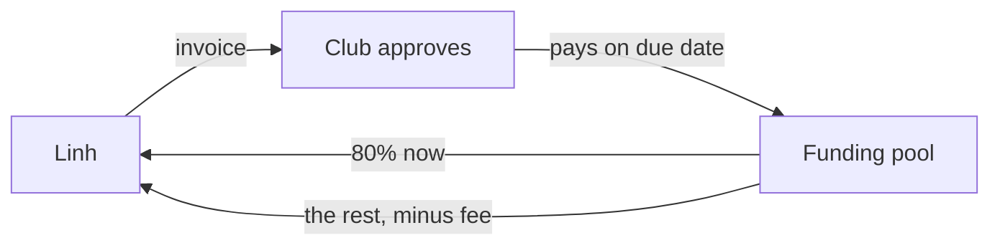

# Zal

**Draw where your money goes. Get paid before the due date.**

## The problem

Linh designs a poster for a student club. The club's treasurer needs two committee members to sign off, then pays by bank transfer 30 days later. When the money lands, Linh moves 10% aside for tax by hand. Linh waits a month for cash that is already agreed, and nobody on either side can see where the money is.

## What Zal does

1. **Money routes itself.** Draw your rules once, for example 10% to tax and the rest to savings. Every payment you receive follows them.
2. **One payment settles both sides.** The club approves the invoice under its own rules (a monthly budget, two signatures above a limit) and pays in one step. The money passes through the club's rules and Linh's routing in the same transaction.
3. **Cash today, not in 30 days.** Once the club approves, a funding pool pays Linh 80% at once. When the club pays, the pool keeps its share plus a fee and the rest goes to Linh.

## Why a blockchain

- **Both sides see the same record.** A payment either completes on both sides or not at all.
- **An approved invoice is a token.** Whoever holds it gets paid, so a funder is repaid without anyone chasing it.

## Try it

Zal runs on its own Avalanche L1 with testnet dollars only, no real money. The sandbox runs the whole story in your browser with bots playing the club and the funder.

App: https://app.100-63-191-30.sslip.io · Product details: [prd.md](prd.md)
