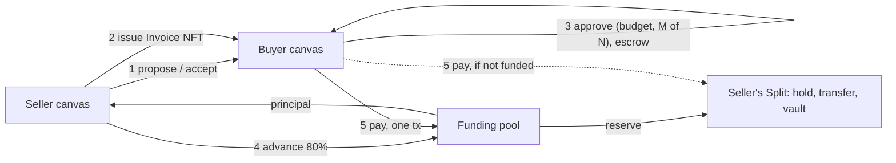

# Zal: a payment canvas on an Avalanche L1

**Program where money goes: connect canvases, settle invoices through both parties' flows in one transaction, and turn approved invoices into cash today.**

## Problem
- Clubs, small teams and freelancers run shared money through a treasurer and a spreadsheet.
- Splits are manual, approvals informal, spending opaque.
- Sellers wait until the due date for working capital.

## Solution
- One canvas per party, the same for everyone. Roles (buyer, seller) live on relationships, not accounts.
- Invoices are NFTs. Buyer approval is an agreement to pay the NFT holder.
- A funding pool advances 80% of an approved invoice now (reverse factoring).

## How it works

## Key features
- Canvas with drafts, ghost (proposed) and solid (committed) nodes; child canvases as gates.
- Relationships by address or invite link.
- Split: up to 8 legs, Hold, Transfer, Vault (simulated yield).
- Budgets per 30 days; M-of-N above a rolling 24 h single-signature allowance.
- Scheduled payments: pay an invoice at a time, or a transfer every ≥ 1 min, run by any keeper.
- Escrow; anyone settles an escrowed invoice after its due date.
- Funding pool: advance against escrow or a buyer credit limit; LPs deposit from any wallet.
- Realtime Inbox, Timeline, Overview charts.
- Sandbox: the real contracts in the browser, with bots for every role.

## Why on-chain, why an L1
| Need | How chain gives it |
|---|---|
| Both canvases agree | One shared state; ghost and solid derive from it |
| Settlement through two flows at once | One atomic transaction |
| Receivable follows the funder | NFT holder is the payment recipient |
| Rules nobody can bypass | Budgets, M-of-N, schedules enforced in the account contract |
| Own L1 | Own gas token and fees, own faucet, allow-list option for real deployment |

## Architecture at a glance
| Layer | Piece |
|---|---|
| Chain | Zalax L1, chain 102026, gas ZAX; `CanvasAccount` per canvas, `RelationshipRegistry`, `ZalInvoice` (ERC-721), `ZalFundingPool` and `ZalVault` (ERC-4626), zUSDC |
| Off-chain | Ponder indexer + `/v1` API + SSE; keeper (gas only); gas faucet |
| Client | Next.js, HeroUI, xyflow; in-browser sandbox on the same bytecode |

Details: [prd.md](prd.md), [../architecture/srd.md](../architecture/srd.md).

## Status (15 Nov 2026)
- Contracts deployed on the L1; testnet zUSDC only.
- App: https://app.100-63-191-30.sslip.io · API: https://api.100-63-191-30.sslip.io
- Live parameters: advance rate 80%, `annualFeeBps` 1521 (proposed), vault yield TBD.

## Risks
- Fee rate, vault yield and relationship TTL not decided.
- Unescrowed financing depends on obligor limits; who sets them is open.
- Fees recognised at repayment, not accrued; no write-down for unpaid funded invoices.
- Open chain: gas is the only brake.
- Success metrics not defined.

## Next steps
- Decide calibration numbers (open questions 4, 6, 8).
- Decide the obligor-limit process (open question 2).
- Seed live pool liquidity for advances.
- Timeline drag through history (T1).
- Bridged USDC via ICTT, outside payments (ADR 0013).
