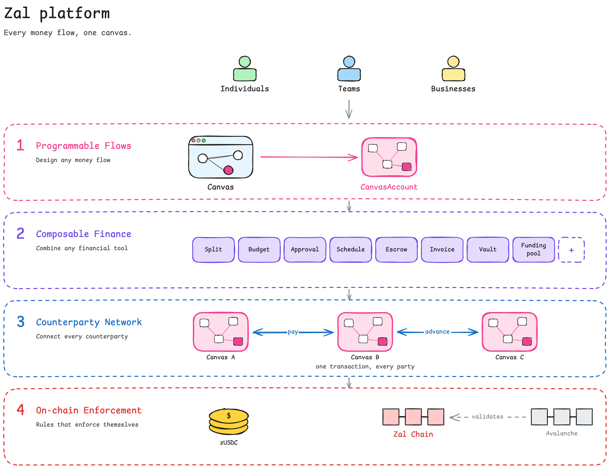

# Zal

**Every money flow, one canvas.**

Programmable payments for individuals, teams and businesses.

## Problem

| | |
|---|---|
| Manual operations | Splits, approvals and reconciliation done by hand |
| Fragmented tools | Bank, spreadsheet and invoice software, each apart |
| Broken settlement | Payments between parties wait and get re-confirmed |
| Trust dependence | Money rules live with whoever keeps the books |

## Solution

1. **Design.** Draw money in and out on a canvas.
2. **Connect.** Link counterparties, issue and approve invoices.
3. **Execute.** One transaction runs every party's rules.

<picture>
  <source media="(prefers-color-scheme: dark)" srcset="../diagrams/zal-platform.dark.png">
  
</picture>

| Pillar | |
|---|---|
| Programmable Flows | Design any money flow |
| Composable Finance | Combine any financial tool |
| Counterparty Network | Connect every counterparty, one transaction |
| On-chain Enforcement | Contracts enforce the rules |

## Why Avalanche

Own L1 · EVM · fast finality · interchain USDC (planned).

## Try it

Testnet only. The sandbox runs in the browser, no wallet needed.

App: https://app.100-63-191-30.sslip.io · Features: [product-doc.md](product-doc.md) · Spec: [prd.md](prd.md)
