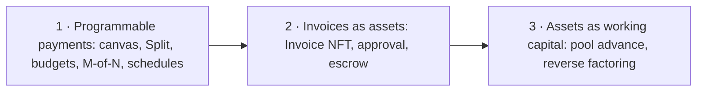
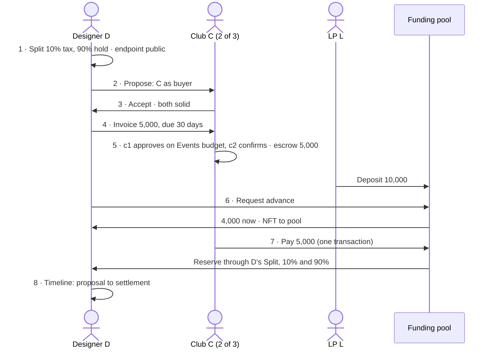

# PRD: Zal

15 Nov 2026 · owner: wyner · status: v1 live on testnet

This file says what Zal does for its users and why. How the system does it (contracts, indexer, keeper, API, state machines, sequences) is in the [SRD](../architecture/srd.md). `ZR-*`, `INV-*` and `AT-*` IDs are in [requirements.md](../architecture/requirements.md). Story codes (C1, R1, I1, …) are cited elsewhere: add new codes, never renumber.

## 1. Summary

Zal gives every party the same on-chain account, drawn as a canvas of nodes and edges, where they set the rules for money coming in and going out. Two canvases form a buyer and seller relationship. The seller issues an invoice as an NFT, the buyer approves and pays it in one transaction that runs through both parties' rules, and a funding pool can advance 80% to the seller as soon as the buyer approves (reverse factoring). It runs on the Zalax L1 (Avalanche, chain id 102026) with testnet zUSDC only.

## 2. Problem

Clubs, small teams and freelancers run shared money through a treasurer, a spreadsheet and bank transfers.

- **Spending:** approvals are informal; nobody enforces a budget or a second signature.
- **Receiving:** splitting income (tax, savings, partners) is manual.
- **Waiting:** a seller with an agreed invoice still waits until the due date for cash.

**First users:** a student club and the people it buys from (designer, print shop), plus a sponsor that pays the club. The demo in §5 uses them.

## 3. Solution in three layers

Each layer builds on the one before.

### Rules every feature follows

1. **One canvas for everyone.** Every party is the same `CanvasAccount`. There is no buyer or seller mode; the palette offers what fits the selection.
2. **Roles belong to relationships.** Buyer and seller label an edge between two canvases, never an account. A club is a seller to its sponsor and a buyer from its designer with the same canvas.
3. **Nothing lands on another canvas without consent.** One side proposes, the other accepts.
4. **Chain state decides what the UI shows.** Whether a node is draft, proposed or committed comes from the chain, never from client state.
5. **The NFT holder gets paid.** Payment goes to `ownerOf(invoiceId)`: the seller, or the pool once funded.
6. **Every action happens on the canvas.** Forms open from nodes, edges and panels. Overview, Docs and Landing only read and navigate. Exceptions: the invite page and the Deposit popover.

### Two kinds of role

| Relationship role | Needs |
|---|---|
| Seller (payee) | Incoming money splits itself; cash before the due date |
| Buyer (payer, obligor) | Budgets, signatures above a limit, scheduled payments |
| Liquidity provider (any wallet, no canvas) | Deposit zUSDC into the pool, earn fees, withdraw idle cash |
| Pool owner | Sets rates; enrols buyers with a credit limit |

| Member role (per canvas) | Can do | Check |
|---|---|---|
| Admin | Everything: relationships, invoices, Split, budgets, members, policy, vault, advance | `onlyAdmin` |
| Approver | Submit, confirm, revoke gated ops; cancel a schedule; edit layout | `onlyApprover` |
| Viewer | Read only | none |

Source: `packages/web/lib/canvas/roles.ts`. A wallet may belong to several canvases (open question 5).

### Terms that are not obvious

| Term | Meaning |
|---|---|
| Draft, ghost, solid | Node states. Draft: on your canvas only, not on-chain. Ghost: on-chain, awaiting the other side. Solid: committed on-chain |
| Split | Your receive route: up to 8 legs (Hold, Transfer, Vault) summing to 100%. Remainder to the last leg; a failing leg falls back to Hold |
| Split visibility | Public or private flag on your Split. Hides the route in the Zal UI only; on-chain it stays readable |
| Gated op | Spend that may need confirmations: approve, escrow, pay, withdraw, create schedule |
| Allowance | Single-signature spend per rolling 24 h for the whole account; above it, M of N applies |
| Escrow | Buyer locks face value in the invoice contract; anyone may settle once due |
| Advance, fee, reserve | Advance = face × 80%, paid now. Fee fixed at advance time from `annualFeeBps` and days to due. Reserve = face − advance − fee, paid to the seller's Split at settlement |
| Obligor limit | Credit line the pool owner gives a buyer canvas; caps its open advance principal |
| Keeper | Anyone who runs a due schedule. Zal runs one that holds gas only |
| Child canvas (gate) | Layout-only group of nodes |
| Sandbox | In-browser chain on the real bytecode, with bots and a movable clock |

## 4. Features

Palette components as in `packages/web/lib/canvas/palette.ts` (`CATALOGUE`), plus Structure from `components/canvas/palette.tsx`.

| Group | Component | Attaches to | What it does | Stories | Status |
|---|---|---|---|---|---|
| Root | Account | nothing | Creates your canvas | C1 | live |
| Relationship | Counterparty | Account | Propose by address, or invite by link | R1, R2, R4 | live |
| Relationship | Split visibility | Account, Split | Set visibility public or private | R3 | live |
| Document | Invoice | Active counterparty you sell to | Issue an Invoice NFT: face value, due in days | I1 | live |
| Spend control | Budget | Account; issued invoice you pay | Add a budget; approve an invoice against it | B1, I2 | live |
| Spend control | Approval | Account (2+ members) | Threshold and 24 h allowance | P3 | live |
| Time | Schedule | Account, counterparty, approved invoice you pay | Pay an invoice at a set time, or transfer once or recurring | P4, P5 | live |
| Time | Stream | nothing | Shown disabled: "Not in v1 contracts" | P4 | not in v1 |
| Allocation | Split | Account | Set legs | P2 | live |
| Commitment | Escrow | Approved invoice you pay | Lock face value | I3 | live |
| Yield | Vault | Account, Split | Deposit, redeem, add a Vault leg. Yield simulated | Y1, P2 | live (yield TBD) |
| Financing | Funding pool | Approved invoice you sell | Take an advance | F1, F2 | live |
| Financing | Pool liquidity | Account, funding pool | Deposit or withdraw as an LP | LP1 | live |
| Structure | Child canvas | Selected non-Account nodes | Group into a gate | C4 | live |

| Surface | What | Stories | Status |
|---|---|---|---|
| Inspector | Details and actions of the selected node | many | live |
| Inbox | Waiting items and notifications, unread per wallet | N1 | live |
| Timeline | Activity in chain order, upcoming due dates | T1 | live (drag through history not built) |
| Overview | Read-only charts and tables | O1 | live |
| Deposit popover | Balances, Get gas, Mint 1,000 testnet zUSDC | G1 | live |
| Canvas switcher | My canvas, canvases added by others | C5 | live |
| Guided demo, sandbox clock | Two tracks from chain state; +1 day, +30 days, Reset | S1 | sandbox only |
| Account withdraw | Gated `withdraw(to, amount)` | n/a | contract only, no UI |

## 5. User stories

Priority: P0 demo-critical, P1 should have, P2 if time allows.

### 5.1 Canvas

| Code | Story | Acceptance criteria | Refs | Pri |
|---|---|---|---|---|
| C1 | As a new user, I connect my wallet and see my canvas with the Account in the centre | No account-type step. A new wallet sees a ghost Account with a Create button; after one tx it is solid with its zUSDC balance | ZR-ACC-01, ZR-ACC-02 | P0 |
| C2 | As a user, I add components and connect edges to build a flow | Selected node: palette shows what fits. Nothing selected: every component an Admin may place is offered as a draft. Dragging a link shows invalid targets disabled; a refused drop states the reason. A connection opens the action's form | ZR-ACC-03 | P0 |
| C3 | As a user, I tell committed from uncommitted at a glance | Draft, ghost and solid look different for every component; state comes from chain, never client | ZR-SYS-02 | P0 |
| C4 | As a user with a large canvas, I group nodes into a child canvas | Select non-Account nodes → Move to child canvas. Gate shows name, node count, money in and out, waiting items. Depth 1. Dissolve returns nodes. Nothing on-chain changes | n/a | P1 |
| C5 | As a member of several canvases, I switch between them | Switcher lists my canvas and canvases added by others; each entry checked on-chain (`roleOf`) before shown; URL carries `?account=` (open question 5) | ZR-ACC-01 | P1 |

### 5.2 Relationships

| Code | Story | Acceptance criteria | Refs | Pri |
|---|---|---|---|---|
| R1 | As a user, I add a counterparty by canvas address or invite link and choose my role | Ghost counterparty on both canvases within seconds. One `Proposed` or `Active` relationship per pair. Proposals never expire in v1 UI (TTL TBD) | ZR-REL-01, ZR-REL-03, AT-02, AT-04 | P0 |
| R2 | As the proposed party, I accept or reject on the ghost node | Only the non-proposer decides. Accept: solid on both. Reject: faded. Proposer may cancel while proposed | ZR-REL-02, AT-03 | P0 |
| R3 | As a seller, I set my Split visibility public or private | Flag stored on the account; set from the Split. Private hides the route in the Zal UI only (open question 3) | ZR-ACC-07 | P0 |
| R4 | As an Admin, I invite someone with no canvas by link | Admin signs an invite (valid 7 days). Invitee opens `/app/invite/:id`, creates a canvas, accepts; relationship `Active` in one tx. Replay, expiry and own-invite are refused. Live mode only | ZR-REL-03, AT-04 | P1 |

### 5.3 Invoices

| Code | Story | Acceptance criteria | Refs | Pri |
|---|---|---|---|---|
| I1 | As a seller, I issue an invoice on an active relationship | Face > 0, due date in the future. NFT minted to me; ghost invoice on both canvases. I can cancel while `Issued` | ZR-INV-01, ZR-INV-05, AT-05 | P0 |
| I2 | As a buyer, I approve an invoice against a budget | Approval is a gated op. Budget used + face ≤ limit, else refused. Invoice solid. Or reject it | ZR-INV-02, ZR-ACC-06, AT-06 | P0 |
| I3 | As a buyer, I escrow an approved invoice | Exactly face value, once. Escrow node shows the locked amount | ZR-INV-03, AT-07 | P1 |
| I4 | As anyone, I settle an escrowed invoice after its due date | "Settle from escrow" appears once due; before due it reverts | ZR-PAY-03, AT-11, AT-19 | P1 |

### 5.4 Payments and Split

| Code | Story | Acceptance criteria | Refs | Pri |
|---|---|---|---|---|
| P1 | As a buyer, I pay an invoice and see money pass through both flows | One tx: buyer → pool if funded → seller's Split. Pays `ownerOf(id)`. Balances update on both canvases | ZR-PAY-01, ZR-PAY-02, ZR-PAY-04, AT-09, AT-10 | P0 |
| P2 | As a seller, I split incoming money with Split and Vault legs | ≤ 8 legs, Σ = 100%; remainder to last leg; a failing leg holds instead of reverting | ZR-ACC-07..09, AT-01, AT-15, AT-20 | P0 |
| P3 | As a canvas with 2+ members, I require M of N above an allowance | Policy "m of n above X per 24 h". Ops over the remaining allowance wait for threshold; splitting a payment does not avoid it; member or policy change voids pending ops | ZR-ACC-04, ZR-ACC-05, ZR-ACC-11, AT-07, AT-13, AT-26, AT-27 | P1 |
| P4 | As a buyer, I schedule payment of an approved invoice at a chosen time | Gated like a spend. Start ≥ 60 s ahead. Keeper runs it; anyone may. Paid from escrow if locked, else balance. Approver cancels. Stream: not in v1 | ZR-SCH-01..07, AT-22, AT-24, AT-25 | P2 |
| P5 | As a canvas, I schedule a fixed transfer once or every interval | Recipient fixed, not self. Interval ≥ 60 s, 1–1,000 runs. Policy amount = per run × runs. A run with short balance reverts and stays due | ZR-SCH-01..07, AT-21, AT-23, AT-27 | P2 |

### 5.5 Budgets, vault, members

| Code | Story | Acceptance criteria | Refs | Pri |
|---|---|---|---|---|
| B1 | As a buyer, I add a budget with a limit per 30 days | Needs a relationship where I buy. Period rolls; used resets. Schedules are not charged against budgets in v1 | ZR-ACC-06, AT-06 | P1 |
| Y1 | As an Admin, I park idle money in the Vault | Deposit and redeem. Yield simulated, stated once in the shell and Docs; rate TBD | ZR-VLT-01 | P2 |
| M1 | As an Admin, I add an approver to my canvas | Adds Approver role. Approval node appears at 2+ members. Viewer and Admin assignment and removal: contract only, no UI | ZR-ACC-02, ZR-ACC-05 | P1 |

### 5.6 Funding

| Code | Story | Acceptance criteria | Refs | Pri |
|---|---|---|---|---|
| F1 | As a seller of an approved invoice, I take an advance | Form shows advance now, fee (fixed now), reserve at payment. I receive face × 80% into Hold. NFT moves to the pool; recipient becomes the pool; buyer sees a funded badge | ZR-FND-01..04, ZR-INV-04, AT-08, AT-09, AT-12 | P1 |
| F2 | As a seller to an enrolled buyer, I take an advance without escrow | Allowed only if buyer's open principal + new ≤ obligor limit. Self-dealing pair with no escrow and no limit is refused | ZR-FND-07, AT-17, AT-18 | P1 |
| LP1 | As any wallet, I deposit to and withdraw from the pool | No canvas needed. Withdrawals capped by idle cash | ZR-FND-05, ZR-FND-06, AT-14 | P1 |

### 5.7 Notifications, timeline, overview

| Code | Story | Acceptance criteria | Refs | Pri |
|---|---|---|---|---|
| N1 | As a member, I am told what needs me | Six kinds: proposal received, invoice issued to you, signature needed, payment received, advance paid, schedule ran. Toast, Inbox glow, unread count in the sidebar; read state per wallet. Click flies to the node, opening its child canvas | ZR-SYS-02 | P0 |
| T1 | As a user, I see what happened and what is coming | Timeline lists activity in chain order and the next due date. Sandbox: jump to due date. Dragging through history: not built | ZR-SYS-02 | P2 |
| O1 | As a user, I read my money at a glance | Overview: balance per day, cash in and out per week, routed by Split, waiting for you, early cash, funding pool, obligor credit, invoices by status, upcoming due dates. Read-only; rows open the canvas at the node | ZR-SYS-02 | P1 |

### 5.8 Sandbox and onboarding

| Code | Story | Acceptance criteria | Refs | Pri |
|---|---|---|---|---|
| S1 | As a visitor, I run the whole demo alone | One switch (or `/app/canvas?sandbox=1`). Canvas created and funded; bots act as club, print shop, co-signer, keeper, LP. Guided demo tracks seller steps 1–8 and buyer+LP steps. Clock advances; Reset starts over. Every sandbox value is labelled sandbox | AT-01..AT-27 on the same bytecode | P0 |
| G1 | As a new live user, I get gas and testnet zUSDC without help | Deposit shows gas; "Get gas" drips 0.05 ZAX while below 0.01 ZAX (one per wallet, five per IP per 24 h). Mint 1,000 testnet zUSDC to wallet or canvas | n/a | P0 |

## 6. The demo, end to end

Designer D, club C (members c1 c2 c3, threshold 2), pool P, LP L. It mirrors the acceptance tests. Per-flow detail is in the SRD: invite §6.2, approval §6.4 and §5.6, settlement §6.5 and §6.6, advance §6.7, schedule §6.9.

| Step | Amount | Source |
|---|---|---|
| Advance | 4,000 | face × `advanceRateBps` 8000 |
| Fee | ≈ 50 (50.005480 at `annualFeeBps` 1521 with exactly 30 days left) | ZR-FND-02 |
| Reserve | 5,000 − 4,000 − fee | ZR-FND-04 |

The live L1 cannot warp time, so step 7 pays early. The fee was fixed at advance, so amounts do not change. The sandbox can reach the due date.

## 7. Screens and UI rules

| Screen | Shows |
|---|---|
| Landing `/` | "Program where money goes", facts (advance rate, 1 tx settlement, Avalanche L1, testnet USDC, sandbox), Open app, Try sandbox |
| Canvas `/app/canvas` | Palette, Inspector, Inbox, Timeline, Guided demo and clock (sandbox), tool bar, minimap, node context menu, live bar |
| Overview `/app/overview` | Read-only money summary (O1) |
| Docs `/app/docs` | Getting started, sandbox demo as seller, as buyer and LP, what the labels mean |
| Invite `/app/invite/:id` | Create canvas, then accept. Refuses: not found, redeemed, expired, own invite, sandbox on |

- Copy is terse and formula-first: "2 of 3 above 1,000 per 24 h", "Reserve at payment".
- A refused action states its rule: "Only the seller issues invoices".
- Money is the highlighted value in every row; zUSDC with 6 decimals.
- One "testnet" badge in the shell; Docs say zUSDC is testnet and vault yield simulated. No such labels per amount. Sandbox values labelled sandbox.
- Both canvases update within seconds, no reload.
- Everything on-chain is public. "Private" and per-party views are UI rules, not privacy. A counterparty shows as one node; its internal flow is not drawn.
- HeroUI v3 and xyflow defaults, one icon set. Desktop only.

## 8. Scope

| In v1 (live on the L1) | Not in v1 |
|---|---|
| Canvas, child canvases | Stream (continuous payment) |
| Relationships by address and invite link | Ending an active relationship |
| Invoice NFTs: issue, approve, reject, cancel, escrow, pay | Buyer-created invoices or purchase orders (open question 1) |
| Split with Hold, Transfer, Vault legs | Real privacy of routes |
| Budgets, M of N with 24 h allowance, schedules and keeper | Budget charging by schedules |
| Funding pool: escrow and obligor-limit paths, LP deposit and withdraw | Credit scoring, recourse, overdue, disputes, fee accrual (K-1), write-downs (K-2), invoice resale |
| Inbox, Timeline (list), Overview, realtime via SSE | Timeline drag through history |
| Sandbox, gas faucet, testnet mint | Real money, KYC, fiat, bridged USDC, mainnet, mobile |

Deployed parameters (`packages/contracts/deployments/l1.json`): `advanceRateBps` 8000, `annualFeeBps` 1521, `vaultSimulatedApyBps` 0. TxAllowList off: anyone can transact. Endpoints: [l1-hosting.md](../runbooks/l1-hosting.md).

## 9. Open questions and known gaps

Tracked in [open-questions.md](../architecture/open-questions.md). Do not fill a TBD here.

| Item | Status |
|---|---|
| Success metrics | TBD. None defined |
| Fee rate `annualFeeBps` | 1521 deployed, marked proposed (OQ 6) |
| Vault simulated yield | TBD, deployed 0 (OQ 8) |
| Relationship TTL | TBD; proposals do not expire (OQ 4) |
| Who sets obligor limits, on what evidence | Open (OQ 2) |
| Advance paid to Split or Hold | Hold in v1 (OQ 7) |
| Endpoint default public or private | Open (OQ 3) |
| Pool fee recognised at repayment, not accrued | Known issue K-1 |
| Unpaid funded invoice overstates pool assets | Known issue K-2 |
| Live pool liquidity | Advances need LP deposits first |
| Open chain | Gas is the only brake; faucet limits per wallet and IP |

## Terminology sources

Request Network (payee, payer, payment recipient), Superfluid (flow, flow rate), Trade Finance Global (reverse factoring), Resolve (advance rate, reserve, recourse), Huma Finance whitepaper (receivable-backed lending pool).
