# PRD: Zal

15 Nov 2026 · owner: wyner · status: v1 live on testnet

Product view only. System internals (contracts, indexer, keeper, API) are in [../architecture/srd.md](../architecture/srd.md). Requirement IDs (`ZR-*`), invariants (`INV-*`) and acceptance tests (`AT-*`) are in [../architecture/requirements.md](../architecture/requirements.md). Story codes below (C1, R1, I1, …) are stable and cited elsewhere: add new codes, never renumber.

## 1. Summary

| | |
|---|---|
| Problem | Groups, clubs and freelancers run shared money through a treasurer and a spreadsheet. Splits are manual, approvals informal, sellers wait until the due date for cash |
| Users | Anyone with a wallet. One canvas per party: a person, a club, a small business |
| Solution | A payment canvas: one `CanvasAccount` per party, programmed with nodes and edges. Two canvases form a buyer and seller relationship. Invoices are NFTs. Settlement runs through both parties' flows in one transaction. A funding pool advances cash against buyer-approved invoices (reverse factoring) |
| Network | Zalax L1 on Avalanche Fuji: chain id 102026, gas token ZAX, money zUSDC (testnet) |
| Status | v1 contracts deployed 15 Nov 2026 (block 24). Web, API, keeper and gas faucet live. Sandbox runs in the browser. Testnet only |

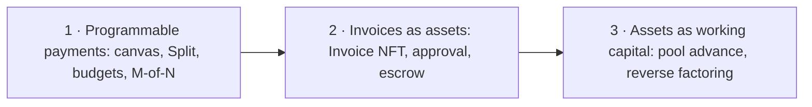

## 2. Problem, goals, non-goals

| Goals (v1) | Non-goals (v1) |
|---|---|
| Every party gets the same canvas; no account type (ADR 0002) | Real money, mainnet, KYC, fiat or VND conversion |
| Program where incoming money goes (Split, Vault, Hold) | Credit scoring; the advance rate is fixed at 80% |
| Buyer approval, escrow and payment of Invoice NFTs, one-transaction settlement | Disputes, overdue handling, recourse, write-downs |
| Spend control: budgets, M-of-N above a rolling 24 h allowance, scheduled payments | Stream (continuous payment) |
| Early cash for sellers from a funding pool, safe against self-dealing (ADR 0009) | Bridging inside payments (ADR 0013); secondary market for invoices (ADR 0005) |
| Try everything alone in a sandbox on the real bytecode (ADR 0007) | Mobile layout; the canvas targets desktop |

**Success metrics.** TBD. None are defined.

## 3. Design principles

1. **Every action on the canvas.** Forms open from nodes, edges and floating panels. Overview, Docs and the landing page only read and navigate. Exceptions: the invite page, and the Deposit popover (gas and testnet mint).
2. **One canvas for every user.** Same components for everyone. The palette shows what fits the selection; there is no buyer or seller mode.
3. **Roles belong to relationships.** Buyer and seller are labels on an edge between two canvases, never on an account.
4. **Propose, then accept.** Nothing lands on another canvas without its consent.
5. **Real time.** Both canvases update within seconds, no reload (ADR 0008, 0012).
6. **Draft, ghost, solid.** The shape tells what is binding (ADR 0003).

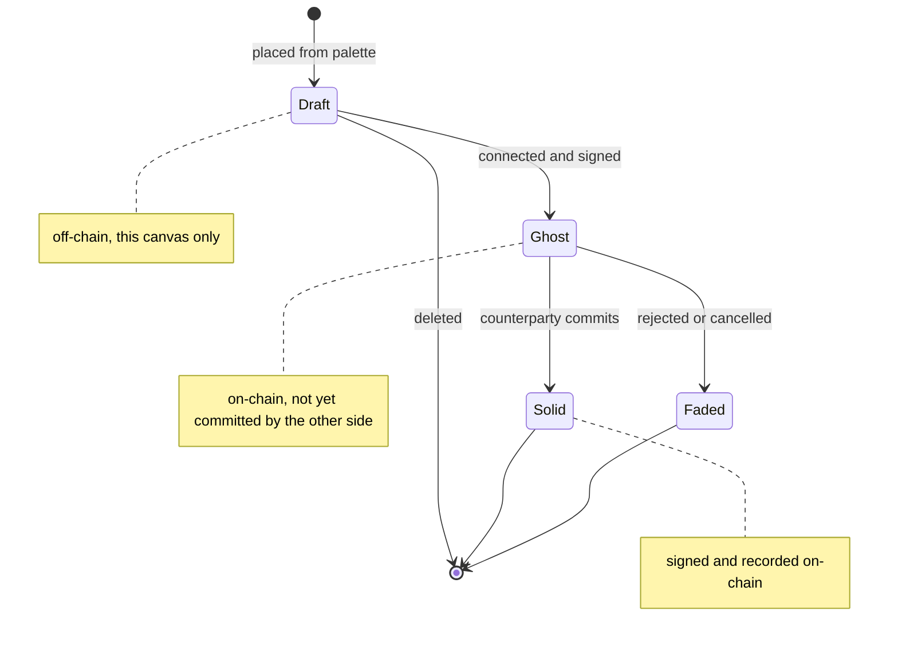

## 4. Personas and roles

Two independent role axes. A relationship role describes one party in one relationship. A member role describes one wallet on one canvas.

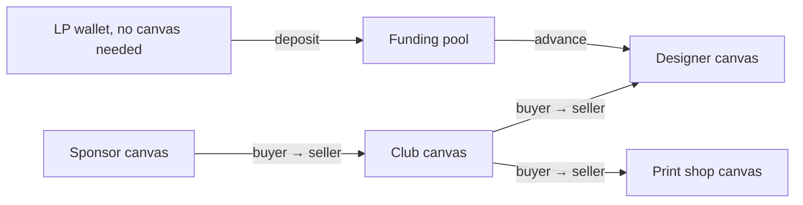

The club is a seller to the sponsor and a buyer from the designer, with the same canvas.

| Relationship role | Example | Needs |
|---|---|---|
| Seller (payee) | Freelance designer, print shop | Incoming money splits itself; cash before the due date |
| Buyer (payer, obligor) | Student club | Budgets, signatures above a limit, scheduled payments, a clear view of where money goes |
| Liquidity provider | Any wallet | Deposit zUSDC into the pool, earn the fees, withdraw idle cash |
| Pool owner | Protocol owner | Sets rates and enrols buyers with a credit limit (ADR 0009) |

| Member role (per canvas) | Can do | Contract check |
|---|---|---|
| Admin | Everything: relationships, invoices, Split, budgets, members, policy, vault, advance | `onlyAdmin` |
| Approver | Submit, confirm and revoke gated ops (approve, escrow, pay, schedule, withdraw); cancel a schedule; edit layout (ADR 0014) | `onlyApprover` |
| Viewer | Read only | none |

Source: `packages/web/lib/canvas/roles.ts`. A wallet may be a member of several canvases and switches between them (open question 5).

## 5. Glossary (Zal terms only)

| Term | Meaning |
|---|---|
| Canvas | One party's workspace, backed by one `CanvasAccount` contract |
| Account node | The canvas root: holds zUSDC, start and end of every flow. Always on the root canvas |
| Draft | A node or link placed on your own canvas but not on-chain; dashed accent outline, labelled Draft |
| Ghost | On-chain but not committed by the other side (proposed relationship, issued invoice) |
| Solid | Signed and recorded on-chain (active relationship, approved or paid invoice) |
| Relationship | Buyer and seller edge between two canvases; `Proposed`, `Active`, `Rejected`, `Cancelled` |
| Invite link | Signed off-chain invite; redeemed in one transaction by someone with no canvas yet |
| Payee endpoint | Visibility flag of your Split: public or private. Hides the route in the Zal UI only; on-chain the route is readable |
| Split | Your receive route: up to 8 legs summing to 100%. Leg kinds Hold, Transfer, Vault |
| Leg | One branch of the Split. A failing leg falls back to Hold |
| Payment recipient | Current holder of the Invoice NFT: the seller, or the pool once funded |
| Escrow | Buyer locks the invoice's face value in the invoice contract; afterwards anyone may settle once due |
| Budget | Spend cap per 30-day period, charged when an invoice is approved against it |
| Gated op | Spend action that needs confirmations: approve, escrow, pay, withdraw, create schedule |
| Allowance (spend window) | Single-signature spend allowed per rolling 24 h for the whole account; above it, the threshold applies (ADR 0016) |
| Schedule | On-chain payment plan in the account: pay one invoice at a time, or transfer a fixed amount once or every interval (ADR 0015) |
| Keeper | Any caller that runs a due schedule. Zal runs one; it holds gas only |
| Advance | Principal the pool pays the seller now: face × 80% |
| Fee | Pool fee fixed at advance time from `annualFeeBps` and days to due |
| Reserve | face − principal − fee, paid to the seller's Split at settlement |
| Obligor limit | Credit line the pool owner gives a buyer canvas; caps its open advance principal |
| Funded | Invoice NFT held by the pool |
| Child canvas, gate | Layout-only container for nodes; drawn in the parent as a gate (ADR 0011) |
| Sandbox | In-browser chain running the real contracts, with bots and a movable clock (ADR 0007) |

## 6. Feature catalogue

Palette components exactly as in `packages/web/lib/canvas/palette.ts` (`CATALOGUE`), plus the Structure entry from `components/canvas/palette.tsx`. Status: **live** = on the L1 and in the sandbox; **sandbox only**; **not in v1**.

| Group | Component | Attaches to | What it does | Stories | Status |
|---|---|---|---|---|---|
| Root | Account | nothing | Creates your canvas (one per canvas) | C1 | live |
| Relationship | Counterparty | Account | Propose a relationship by address, or invite by link | R1, R2, R4 | live |
| Relationship | Payee endpoint | Account, Split | Set endpoint visibility public or private | R3 | live |
| Document | Invoice | Counterparty you sell to (active) | Issue an Invoice NFT: face value, due in days | I1 | live |
| Spend control | Budget | Account; issued invoice you pay | Add a budget; on an invoice, approve against it | B1, I2 | live |
| Spend control | Approval | Account (2+ members) | Set threshold and 24 h single-signature allowance | P3 | live |
| Time | Schedule | Account, counterparty, approved invoice you pay | Pay an invoice at a set time, or a transfer once or recurring | P4, P5 | live |
| Time | Stream | nothing | Shown disabled: "Not in v1 contracts" | P4 | not in v1 |
| Allocation | Split | Account | Set Split legs (Hold, Transfer, Vault) | P2 | live |
| Commitment | Escrow | Approved invoice you pay | Lock face value | I3 | live |
| Yield | Vault | Account, Split | Deposit/redeem; on a Split, add a Vault leg. Yield simulated | Y1, P2 | live (yield TBD) |
| Financing | Funding pool | Approved invoice you sell | Take an advance | F1, F2 | live |
| Financing | Pool liquidity | Account, funding pool | Deposit from or withdraw to your wallet as an LP | LP1 | live |
| Structure | Child canvas | Selected non-Account nodes | Group into a gate; layout only | C4 | live |

Other surfaces.

| Surface | What | Stories | Status |
|---|---|---|---|
| Inspector | Details and actions of the selected node: accept, reject, cancel, pay, sign, settle, cancel schedule | many | live |
| Inbox | Waiting items plus notification feed, unread per wallet | N1 | live |
| Timeline | Activity in chain order, upcoming due dates; "Jump to due date" in the sandbox | T1 | live (drag-through-history not built) |
| Guided demo | Two tracks that tick from chain state | S1 | sandbox only |
| Sandbox clock | +1 day, +30 days, Reset | S1 | sandbox only |
| Deposit popover | Canvas and wallet balance, gas, Get gas, Mint 1,000 testnet zUSDC | G1 | live |
| Canvas switcher | My canvas, canvases added by others | C5 | live |
| Overview | Read-only charts and tables | O1 | live |
| Account withdraw | Gated `withdraw(to, amount)` | n/a | contract only, no UI |

## 7. User stories

Priority: P0 demo-critical, P1 should have, P2 if time allows. New codes are marked *new*.

### 7.1 Canvas

| Code | Story | Acceptance criteria | Refs | Pri |
|---|---|---|---|---|
| C1 | As a new user, I connect my wallet and see my canvas with the Account in the centre | No account-type step. A new wallet sees a ghost Account with a Create button; after one tx it is solid with its zUSDC balance | ZR-ACC-01, ZR-ACC-02 | P0 |
| C2 | As a user, I add components and connect edges to build a flow | Selected node: palette shows what fits. Nothing selected: every component an Admin may place is offered as a draft. Dragging a link shows invalid targets disabled; a refused drop states the reason. A connection opens the action's form | ZR-ACC-03 | P0 |
| C3 | As a user, I tell committed from uncommitted at a glance | Draft, ghost and solid look different for every component; state comes from chain, never client (ADR 0003) | ZR-SYS-02 | P0 |
| C4 *new* | As a user with a large canvas, I group nodes into a child canvas | Select non-Account nodes → Move to child canvas. Gate shows name, node count, money in and out, waiting items. Depth 1. Dissolve returns nodes. Nothing on-chain changes (ADR 0011) | n/a | P1 |
| C5 *new* | As a member of several canvases, I switch between them | Switcher lists my canvas and canvases added by others; each entry checked on-chain (`roleOf`) before shown; URL carries `?account=` (open question 5) | ZR-ACC-01 | P1 |

### 7.2 Relationships

| Code | Story | Acceptance criteria | Refs | Pri |
|---|---|---|---|---|
| R1 | As a user, I add a counterparty by canvas address or invite link and choose my role | Ghost counterparty on both canvases within seconds. One `Proposed` or `Active` relationship per pair. Proposals never expire in v1 UI (TTL TBD) | ZR-REL-01, ZR-REL-03, AT-02, AT-04 | P0 |
| R2 | As the proposed party, I accept or reject on the ghost node | Only the non-proposer decides. Accept: solid on both. Reject: faded. Proposer may cancel while proposed | ZR-REL-02, AT-03 | P0 |
| R3 | As a seller, I set my payee endpoint public or private | Flag stored on the account; shown on my Split node. Private hides the route in the Zal UI only (open question 3) | ZR-ACC-07 | P0 |
| R4 *new* | As an Admin, I invite someone with no canvas by link | Admin signs an invite (valid 7 days). Invitee opens `/app/invite/:id`, creates a canvas, accepts; relationship `Active` in one tx. Replay, expiry and own-invite are refused. Live mode only | ZR-REL-03, AT-04 | P1 |

### 7.3 Invoices

| Code | Story | Acceptance criteria | Refs | Pri |
|---|---|---|---|---|
| I1 | As a seller, I issue an invoice on an active relationship | Face > 0, due date in the future. NFT minted to me; ghost invoice on both canvases. I can cancel while `Issued` | ZR-INV-01, ZR-INV-05, AT-05 | P0 |
| I2 | As a buyer, I approve an invoice against a budget | Approval is a gated op. Budget used + face ≤ limit, else refused. Invoice solid. Or reject it | ZR-INV-02, ZR-ACC-06, AT-06 | P0 |
| I3 | As a buyer, I escrow an approved invoice | Exactly face value, once. Escrow node shows the locked amount | ZR-INV-03, AT-07 | P1 |
| I4 *new* | As anyone, I settle an escrowed invoice after its due date | "Settle from escrow" appears once due; before due it reverts | ZR-PAY-03, AT-11, AT-19 | P1 |

### 7.4 Payments and Split

| Code | Story | Acceptance criteria | Refs | Pri |
|---|---|---|---|---|
| P1 | As a buyer, I pay an invoice and see money pass through both flows | One tx: buyer → pool if funded → seller's Split. Pays `ownerOf(id)`. Balances update on both canvases | ZR-PAY-01, ZR-PAY-02, ZR-PAY-04, AT-09, AT-10 | P0 |
| P2 | As a seller, I split incoming money with Split and Vault legs | ≤ 8 legs, Σ = 100%; remainder to last leg; a failing leg holds instead of reverting | ZR-ACC-07..09, AT-01, AT-15, AT-20 | P0 |
| P3 | As a canvas with 2+ members, I require M of N above an allowance | Policy "m of n above X per 24 h". Ops over the remaining allowance wait for threshold; splitting a payment does not avoid it; member or policy change voids pending ops | ZR-ACC-04, ZR-ACC-05, ZR-ACC-11, AT-07, AT-13, AT-26, AT-27 | P1 |
| P4 | As a buyer, I schedule payment of an approved invoice at a chosen time | Gated like a spend. Start ≥ 60 s ahead. Keeper runs it; anyone may. Paid from escrow if locked, else balance. Approver cancels. Stream: not in v1 | ZR-SCH-01..07, AT-22, AT-24, AT-25 | P2 |
| P5 *new* | As a canvas, I schedule a fixed transfer once or every interval | Recipient fixed, not self. Interval ≥ 60 s, 1–1,000 runs. Policy amount = per run × runs. A run with short balance reverts and stays due | ZR-SCH-01..07, AT-21, AT-23, AT-27 | P2 |

### 7.5 Budgets, vault, members

| Code | Story | Acceptance criteria | Refs | Pri |
|---|---|---|---|---|
| B1 *new* | As a buyer, I add a budget with a limit per 30 days | Needs a relationship where I buy. Period rolls; used resets. Schedules are not charged against budgets in v1 | ZR-ACC-06, AT-06 | P1 |
| Y1 *new* | As an Admin, I park idle money in the Vault | Deposit and redeem. Yield labelled simulated everywhere; rate TBD | ZR-VLT-01 | P2 |
| M1 *new* | As an Admin, I add an approver to my canvas | Adds Approver role. Approval node appears at 2+ members. Viewer and Admin assignment and removal: contract only, no UI | ZR-ACC-02, ZR-ACC-05 | P1 |

### 7.6 Funding

| Code | Story | Acceptance criteria | Refs | Pri |
|---|---|---|---|---|
| F1 | As a seller of an approved invoice, I take an advance | Form shows advance now, fee (fixed now), reserve at payment. I receive face × 80% into Hold. NFT moves to the pool; recipient becomes the pool; buyer sees a funded badge | ZR-FND-01..04, ZR-INV-04, AT-08, AT-09, AT-12 | P1 |
| F2 *new* | As a seller to an enrolled buyer, I take an advance without escrow | Allowed only if buyer's open principal + new ≤ obligor limit. Self-dealing pair with no escrow and no limit is refused | ZR-FND-07, AT-17, AT-18 | P1 |
| LP1 *new* | As any wallet, I deposit to and withdraw from the pool | No canvas needed. Withdrawals capped by idle cash | ZR-FND-05, ZR-FND-06, AT-14 | P1 |

### 7.7 Notifications, timeline, overview

| Code | Story | Acceptance criteria | Refs | Pri |
|---|---|---|---|---|
| N1 *new* | As a member, I am told what needs me | Six kinds: proposal received, invoice issued to you, signature needed, payment received, advance paid, schedule ran. Toast, Inbox glow, unread count in the sidebar; read state per wallet. Click flies to the node, opening its child canvas | ZR-SYS-02 | P0 |
| T1 | As a user, I see what happened and what is coming | Timeline lists activity in chain order and the next due date. Sandbox: jump to due date. Dragging through history: not built | ZR-SYS-02 | P2 |
| O1 *new* | As a user, I read my money at a glance | Overview: balance per day, cash in and out per week, routed by Split, waiting for you, early cash, funding pool, obligor credit, invoices by status, upcoming due dates. Read-only; rows open the canvas at the node | ZR-SYS-02 | P1 |

### 7.8 Sandbox and onboarding

| Code | Story | Acceptance criteria | Refs | Pri |
|---|---|---|---|---|
| S1 | As a visitor, I run the whole demo alone | One switch (or `/app/canvas?sandbox=1`). Canvas created and funded; bots act as club, print shop, co-signer, keeper, LP. Guided demo tracks seller steps 1–8 and buyer+LP steps. Clock advances; Reset starts over. Every sandbox value is labelled sandbox | ADR 0007, AT-01..AT-27 on the same bytecode | P0 |
| G1 *new* | As a new live user, I get gas and testnet zUSDC without help | Deposit shows gas; "Get gas" drips 0.05 ZAX while below 0.01 ZAX (one per wallet, five per IP per 24 h). Mint 1,000 testnet zUSDC to wallet or canvas | n/a | P0 |

## 8. User journeys

### 8.1 Onboarding (live)

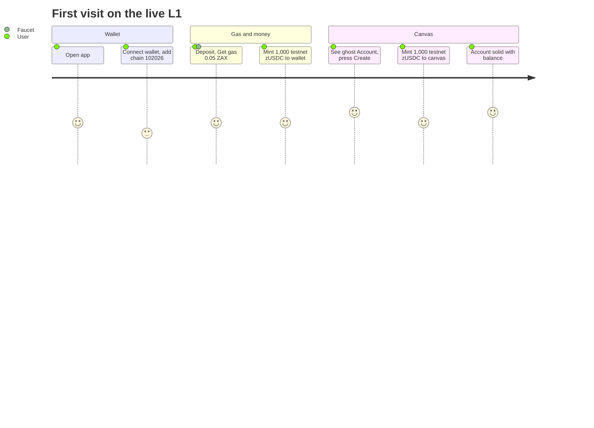

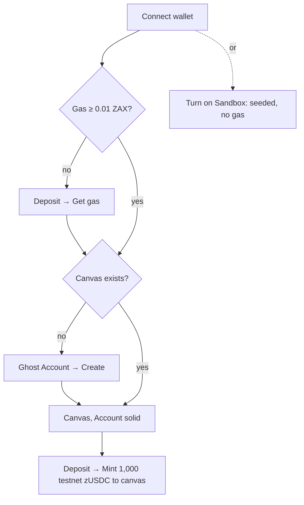

### 8.2 Canvas interaction

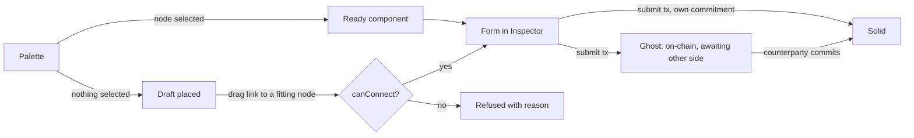

### 8.3 End-to-end demo: designer D and club C

Mirrors the acceptance tests (designer D, club C with members c1 c2 c3, threshold 2, pool P, LP L). User level only; internals in the SRD.

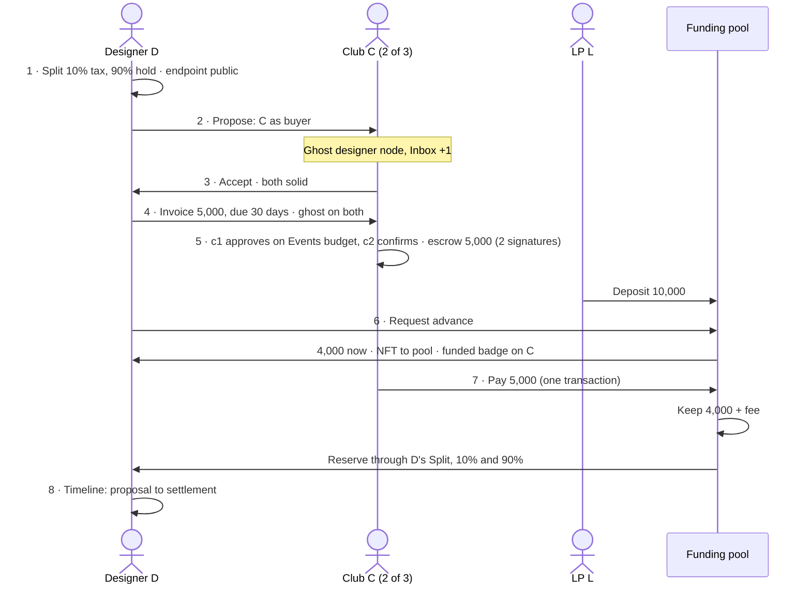

Live L1 cannot warp time: step 7 pays early on-chain; the fee was fixed at advance, so amounts do not change (ADR 0004). The sandbox can reach the due date.

| Step | Amount | Source |
|---|---|---|
| Advance (principal) | 4,000 | face × `advanceRateBps` 8000 |
| Fee | ≈ 50 (50.005480 at `annualFeeBps` 1521 with exactly 30 days left) | ZR-FND-02 |
| Reserve | 5,000 − 4,000 − fee | ZR-FND-04 |

### 8.4 Invoice lifecycle (user view)

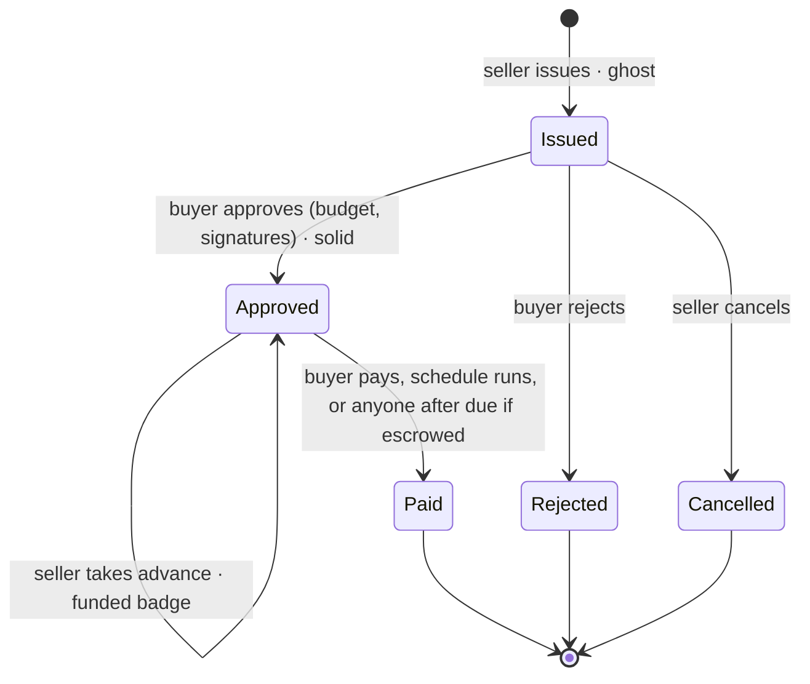

### 8.5 Approval: M of N with a 24 h allowance

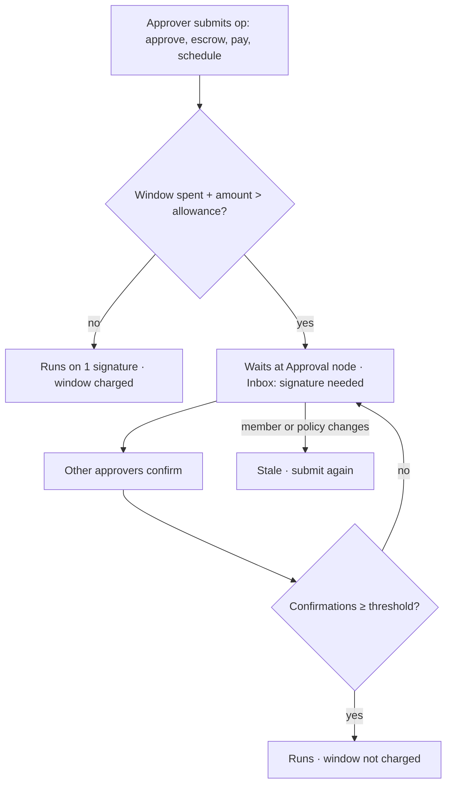

Window restarts 24 h after it opened. The check runs at execution, not submission (ADR 0016).

### 8.6 Scheduled payment

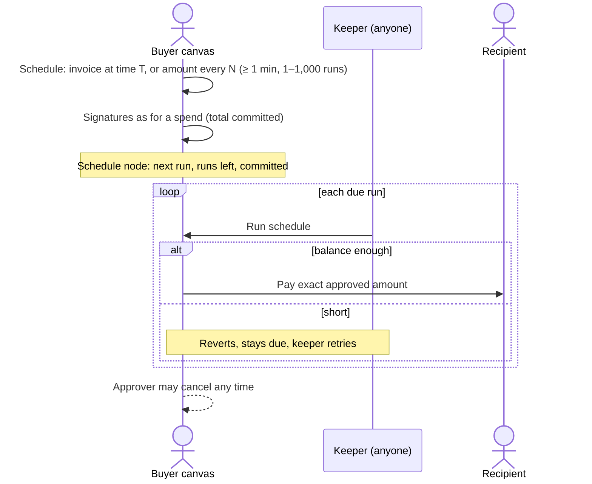

### 8.7 Funding: advance and repayment

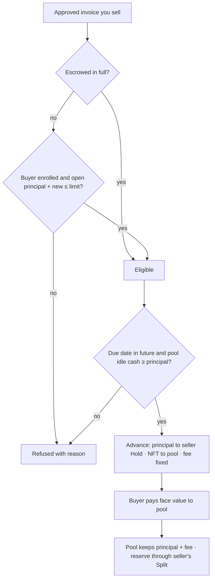

### 8.8 Relationship by invite link

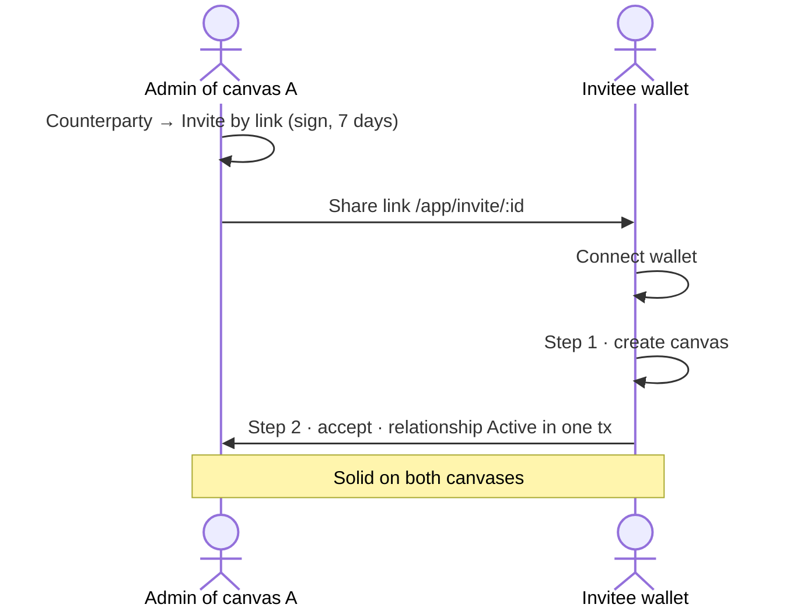

## 9. Real time and visibility

| Event | Actor's canvas | Counterparty's canvas |
|---|---|---|
| Propose relationship | Their node ghost | Your node ghost; Inbox: proposal received |
| Accept | Solid, edge shows role | Solid, edge shows opposite role |
| Reject | Faded | Faded |
| Issue invoice | Ghost invoice | Ghost invoice with Approve / Reject; Inbox: invoice issued |
| Approve | Solid | Solid |
| Advance | Invoice funded, recipient is pool | Funded badge; Inbox: advance paid (seller) |
| Payment | Balances update | Inbox: payment received |
| Schedule run | Runs left decrements | Inbox: schedule ran |

- You open only canvases where your wallet is a member. A counterparty shows as one node; its internal flow is not drawn.
- Everything on-chain is public. "Private" endpoint and per-party views are UI rules, not privacy.

## 10. Screens and IA

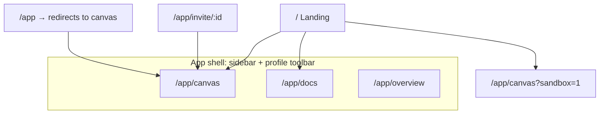

| Screen | Shows |
|---|---|
| Landing `/` | "Program where money goes"; chips Programmable payments, Invoice NFTs, Early cash, Avalanche L1; facts: advance rate, 1 tx settlement, Avalanche L1, testnet USDC, in-browser sandbox; Open app, Try sandbox; 3D globe |
| Sidebar | Overview, Canvas (with unread count), canvas switcher, Docs. Profile toolbar: wallet, network, Sandbox switch, theme, Deposit, disconnect |
| Canvas | Palette (left), Inspector (right), Inbox, Timeline, Guided demo (sandbox), sandbox clock, tool bar (select, pan, fit), minimap, node context menu (Inspect, Focus, Copy address, Move to child canvas or parent, Open child canvas, Dissolve), live bar ("Live updates paused", "Layout not saved") |
| Overview | Account balance, cash in and out, routed by your Split, waiting for you, early cash, funding pool and utilisation, obligor credit, invoices by status, upcoming due dates |
| Docs | Getting started; sandbox demo as seller; as buyer and LP; what the labels mean |
| Invite | Relationship invite: create canvas (step 1 of 2), accept. Refuses: not found, redeemed, expired, own invite, sandbox on |

## 11. Copy and UI rules

| Rule | Source |
|---|---|
| Terse, formula-first copy: "2 of 3 above 1,000 per 24 h", "Commits = face value", "Reserve at payment" | ADR 0016, forms |
| Money is the highlighted value in every row; amounts in zUSDC with 6 decimals | UI |
| zUSDC labelled testnet; vault yield labelled simulated, in every UI | rule 8, ZR-VLT-01 |
| Sandbox values labelled sandbox | S1 |
| A refused action states its rule ("Only the seller issues invoices") | C2 |
| HeroUI v3 defaults, xyflow defaults, theme-token gradients only, one icon set | ADR 0006 |

## 12. Scope and release

| In v1 (live on the L1) | Out of v1 |
|---|---|
| Canvas, drafts, ghost and solid, child canvases | Stream |
| Relationships by address and invite link | Ending an active relationship |
| Invoice NFTs: issue, approve, reject, cancel, escrow, pay | Buyer-created invoices or purchase orders (open question 1) |
| Split with Hold, Transfer, Vault legs | Real privacy of routes |
| Budgets, M-of-N with 24 h allowance, schedules and keeper | Budget charging by schedules |
| Funding pool: escrow and obligor-limit paths, LP deposit and withdraw | Credit scoring, recourse, overdue, disputes, fee accrual (K-1), write-downs (K-2) |
| Inbox, Timeline (list), Overview, realtime via SSE | Timeline drag through history (T1 remainder) |
| Sandbox, gas faucet, testnet mint | Bridged USDC (ADR 0013), mainnet, mobile |

Live endpoints and addresses: [../runbooks/l1-hosting.md](../runbooks/l1-hosting.md). Deployed parameters (`packages/contracts/deployments/l1.json`): `advanceRateBps` 8000, `annualFeeBps` 1521, `vaultSimulatedApyBps` 0. TxAllowList disabled: anyone can transact.

## 13. Risks and open questions

Tracked in [../architecture/open-questions.md](../architecture/open-questions.md). Do not fill a TBD here.

| Item | Status |
|---|---|
| Fee rate `annualFeeBps` | 1521 deployed; marked proposed, not decided (OQ 6) |
| Vault simulated yield | TBD; deployed 0 (OQ 8) |
| Relationship TTL | TBD; UI proposes with no expiry (OQ 4) |
| Who sets obligor limits, on what evidence | Open (OQ 2) |
| Advance through Split or Hold | Hold in v1 (OQ 7) |
| Endpoint default public or private | Open (OQ 3) |
| Pool fee recognised on repayment, not accrued | Known issue K-1 |
| Unpaid funded invoice overstates pool assets | Known issue K-2 |
| Live pool liquidity | Advances need LP deposits first; no fixed seed on the L1 |
| Open chain, gas only brake | Faucet limits per wallet and IP; TxAllowList off |
| Success metrics | TBD |

## Terminology sources
- Request Network: payee, payer, payment recipient; buyer accepts the invoice.
- Superfluid: flow, flow rate.
- Trade Finance Global: reverse factoring, approved payables financing.
- Resolve: advance rate, reserve, recourse.
- Huma Finance whitepaper: receivable-backed lending pool.
