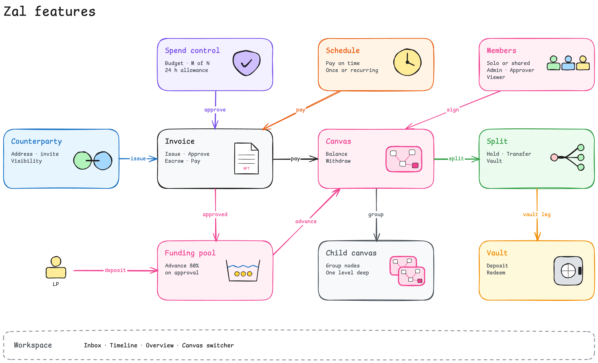

# Zal: Product Document

Sources: [prd.md](prd.md) and [one-pager.md](one-pager.md). Every term follows the [Glossary](#8-glossary).

## Open questions and assumptions

| # | Question | Working assumption |
|---|---|---|
| 1 | Which segment comes first: clubs, small teams or freelancers? | Clubs and their suppliers, as in the PRD |
| 2 | Which direct competitors do we position against? | Spreadsheets, bank transfers and traditional factoring services |
| 3 | Is the liquidity provider a primary persona? | No. It is a secondary role, covered by Feature F11 only |

## 1. Product Headline & Tagline

**Category:** Programmable payments.

**Headline:** Every money flow, one canvas.

**Subheadline:** Approve, pay and split invoices in one transaction. Get 80% of the value as soon as the buyer approves.

| Option | Angle | Headline |
|---|---|---|
| A | Benefit | Program your money once, and Zal runs every payment. |
| B | Pain | Stop splitting payments by hand and waiting 30 days. |
| C | Outcome | Get paid the day your invoice is approved. |

**Why the main headline:**
- Zal is a new category, so readers are problem-aware but not solution-aware (Eugene Schwartz).
- The headline must say what the product is before it states the benefit.
- It carries one idea: every money flow on one canvas.
- The subheadline carries two measurable benefits: one transaction, 80% on approval.
- Option C suits seller-facing channels. It states the narrowest, most concrete benefit.

## 2. Positioning Statement

> For individuals, teams and businesses who run money by rules,
> Zal is a programmable payments platform
> that designs, connects and settles every money flow on one canvas.
> Unlike spreadsheets and bank transfers, Zal enforces the rules in contracts
> and settles both sides of every payment in one transaction.

| Pillar | |
|---|---|
| Programmable Flows | Design any money flow |
| Composable Finance | Combine any financial tool |
| Counterparty Network | Connect every counterparty, one transaction |
| On-chain Enforcement | Contracts enforce the rules |

| Component (April Dunford) | Content |
|---|---|
| Current alternatives | A treasurer, a spreadsheet, bank transfers, approvals by chat |
| Unique attributes | One canvas for every party. Spending and receiving rules run on-chain. Invoices can be advanced |
| Value | Controlled spending, self-splitting income, cash before the due date |
| Best-fit segment | Clubs with a treasurer and several approvers, and their small suppliers |
| Direct competitors | [TO ADD: direct competitors to compare against] |

## 3. Product Story

A club hires a designer and a print shop. The treasurer approves spending by chat and tracks the budget in a spreadsheet. Suppliers wait until the due date, then set tax aside by hand. Nobody sees the whole flow of money.

Zal is the guide. Every party gets the same canvas. The plan has three steps:
1. Draw the rules once: budgets, signatures, how income splits.
2. Connect with a counterparty and issue invoices.
3. Approve and pay. Money runs through both parties' rules.

Action: create a canvas and add the first counterparty. Result: the club spends within budget. Suppliers get 80% the day the invoice is approved. Both sides read the same record.

## 4. Problem & Users

**Problem Statement:**

| Problem | |
|---|---|
| Manual operations | Splits, approvals and reconciliation done by hand |
| Fragmented tools | Bank, spreadsheet and invoice software, each apart |
| Broken settlement | Payments between parties wait and get re-confirmed |
| Trust dependence | Money rules live with whoever keeps the books |

First segment: clubs, small teams and their suppliers (open question 1).

### Personas

| | P1: Club treasurer (Buyer) | P2: Freelance supplier (Seller) |
|---|---|---|
| Context | Manages shared money; two other members must approve | Works for the club: design, printing |
| Jobs-to-be-Done | Spend within budget, with the right approvers; pay on time | Get paid in full and early; set tax and savings aside |
| Pains | Approvals by chat; nobody enforces the budget | Waits 30 days; splits income by hand |
| Gains | Every payment has a rule and a shared record | Cash as soon as the invoice is approved |
| Pain relievers | Budget and Approval policy run on-chain | Split divides every incoming payment |
| Gain creators | Schedules pay on time on their own | Advance of 80% from the Funding pool |

### User Journey

1. Connect a wallet. Create a canvas.
2. Add a counterparty by canvas address or invite link. The counterparty accepts.
3. The seller sets a Split and issues an invoice.
4. The buyer approves the invoice against a Budget, with signatures per the Approval policy.
5. The buyer escrows the invoice or sets a Schedule.
6. The seller takes an Advance from the Funding pool (optional).
7. The buyer pays. Money passes through the Funding pool (if advanced), then into the seller's Split.

## 5. Feature List

Hierarchy: Theme "Programmable payments" > 4 Epics > Features > User Stories.

<picture>
  <source media="(prefers-color-scheme: dark)" srcset="../diagrams/zal-features.dark.png">
  
</picture>
Priority uses MoSCoW (Must, Should, Could, Won't). MVP (Minimum Viable Product) is the v1 now live on testnet.

| ID | Epic | Feature | One-line description | Problem solved | Benefit (FAB) | Priority | Phase |
|---|---|---|---|---|---|---|---|
| F01 | Foundation | Canvas | Each party has one canvas of nodes and edges | Each party uses separate tools | One view of every money flow | Must | MVP |
| F02 | Foundation | Relationships | Add a counterparty by address or invite link | No shared link between two parties | Both sides see the same relationship | Must | MVP |
| F03 | Invoices | Invoices | The seller issues an invoice as an NFT | Invoices are scattered and untracked | One shared invoice status for both sides | Must | MVP |
| F04 | Programmable payments | Budgets | Limit spending per 30-day period | Nobody enforces the budget | No approval exceeds the budget | Must | MVP |
| F05 | Programmable payments | Approval policy | Require M of N signatures above the single-signature limit | Informal approvals | Large payments always have enough approvers | Should | MVP |
| F06 | Invoices | Escrow | The buyer locks the invoice's face value | The seller is unsure of payment | Funds are ready before the due date | Should | MVP |
| F07 | Programmable payments | One-transaction payment | Money passes both parties' rules in one transaction | Records drift between parties | Both sides update together | Must | MVP |
| F08 | Programmable payments | Split | Divide every incoming payment by percentage | Income is split by hand | Set once, applied every time | Must | MVP |
| F09 | Programmable payments | Schedules | Pay an invoice or transfer money on a schedule | Due dates must be remembered | On-time payment with no action | Could | MVP |
| F10 | Working capital | Advance | Get 80% of face value as soon as the invoice is approved | Cash arrives only at the due date | Cash up to 30 days earlier | Should | MVP |
| F11 | Working capital | Liquidity provision | Deposit zUSDC to and withdraw from the Funding pool | The pool needs capital to advance | Earn fees from advances | Should | MVP |
| F12 | Programmable payments | Vault | Park idle money for simulated yield | Idle money earns nothing | A Split leg can earn yield | Could | MVP |
| F13 | Foundation | Child canvases and switching | Group nodes into a child canvas; switch between canvases | Large canvases are hard to read | A tidy canvas at any size | Should | MVP |
| F14 | Foundation | Inbox | Notify what needs action and what money arrived | Pending approvals get missed | Know the next action at once | Must | MVP |
| F15 | Foundation | Timeline | List activity and upcoming due dates | No shared history | Trace every step | Could | MVP |
| F16 | Foundation | Overview | Charts and tables of money flows | No overall picture | Read the money position on one screen | Should | MVP |
| F17 | Foundation | Sandbox | Run the whole flow in the browser with bots | Trying it needs several people | Try the product alone | Must | MVP |
| F18 | Foundation | Gas and testnet zUSDC | Drip gas and mint testnet zUSDC | A new wallet has no gas | Start without help | Must | MVP |
| F19 | Programmable payments | Stream | Pay continuously over time | Pay by time used | [TO ADD: post-MVP scope] | Won't | Post-MVP |

## 6. MVP Feature Details

Codes in brackets are the User Story codes in [prd.md](prd.md).

**F01 Canvas (C1, C2, C3)**
As a member, I want my canvas as soon as I connect a wallet, so I can start without setup.
- Given a wallet with no canvas, When it connects, Then the Account node shows as Draft with a Create button.
- Given the create transaction was sent, When it succeeds, Then the node becomes Committed and shows the zUSDC balance.
- Given an edge dragged to an invalid node, When dropped, Then it is refused and the rule is shown.

**F02 Relationships (R1, R2, R4)**
As an Admin, I want to add a counterparty and choose my role, so both parties can trade.
- Given a valid canvas address, When I propose, Then both canvases show the counterparty as Pending.
- Given a pending proposal, When the proposed party accepts, Then the relationship is Committed on both canvases.
- Given an invite link older than 7 days or already used, When it is opened, Then the invite is refused.

**F03 Invoices (I1)**
As a seller, I want to issue an invoice on an active relationship, so I can request payment.
- Given face value > 0 and a future due date, When I issue, Then an NFT is minted to the seller.
- Given an invoice in Issued state, When the seller cancels, Then the invoice becomes Cancelled.

**F04 Budgets (I2, B1)**
As a buyer, I want to approve invoices against a budget, so I never spend over the limit.
- Given used + face value ≤ limit, When I approve, Then the invoice becomes Approved and the budget is charged.
- Given used + face value > limit, When I approve, Then the action is refused.
- Given a 30-day period ends, When the next period starts, Then used resets to 0.

**F05 Approval policy (P3, M1)**
As a canvas with 2+ members, I want M of N signatures above a limit, so large payments are controlled.
- Given a payment over the remaining single-signature limit for 24 h, When submitted, Then it waits for M signatures.
- Given a pending action, When members or the policy change, Then the pending action is voided.

**F06 Escrow (I3, I4)**
As a buyer, I want to lock funds for an approved invoice, so the seller knows it will be paid.
- Given an Approved invoice, When I escrow, Then exactly the face value is locked, once.
- Given an escrowed invoice past its due date, When anyone pays from escrow, Then the seller is paid.
- Given the due date has not passed, When someone else pays from escrow, Then the transaction is refused.

**F07 One-transaction payment (P1)**
As a buyer, I want to pay an invoice once, so money passes through both parties' rules.
- Given an Approved invoice, When I pay, Then money goes buyer, Funding pool if advanced, then seller's Split, in one transaction.
- Given the transaction succeeds, When both canvases refresh, Then both balances change within seconds.

**F08 Split (P2, R3)**
As a seller, I want incoming money divided by percentage, so I never split it by hand.
- Given up to 8 legs summing to 100%, When I save, Then the Split is stored on-chain.
- Given a division with a remainder, When money splits, Then the remainder goes to the last leg.
- Given a failing leg, When money splits, Then that leg's share stays on the canvas.
- Given Split visibility is private, When others view the canvas in Zal, Then the Split is hidden; it stays readable on-chain.

**F09 Schedules (P4, P5)**
As a buyer, I want to schedule a payment, so it is paid on time with no action.
- Given a start at least 60 seconds ahead, When I create the Schedule, Then it needs approval like a payment.
- Given a due Schedule and enough balance, When the Keeper runs it, Then the money is transferred.
- Given too little balance, When the Keeper runs it, Then the run is reverted and the Schedule stays due.

**F10 Advance (F1, F2)**
As a seller with an approved invoice, I want an Advance, so I get cash before the due date.
- Given full escrow or a buyer with a Credit limit, When I request an Advance, Then I receive 80% of face value.
- Given the invoice was advanced, When I check it, Then the payment recipient is the Funding pool.
- Given no escrow and no Credit limit, When I request an Advance, Then it is refused.

**F11 Liquidity provision (LP1)**
As a liquidity provider, I want to deposit zUSDC into the Funding pool, so I earn fees.
- Given a wallet holding zUSDC, When I deposit, Then I receive pool shares, with no canvas needed.
- Given money is out on advances, When I withdraw, Then the amount is capped by the pool's idle cash.

**F12 Vault (Y1)**
As an Admin, I want to park idle money in the Vault, so it earns yield.
- Given a canvas balance, When I deposit, Then the balance moves to the Vault and can be redeemed.
- The yield is simulated. Rate: [TO ADD: simulated yield rate].

**F13 Child canvases and switching (C4, C5)**
As a member with a large canvas, I want to group nodes into a child canvas, so the canvas stays readable.
- Given selected nodes other than the Account node, When I group them, Then they move into a child canvas and nothing changes on-chain.
- Given I belong to several canvases, When I open the canvas switcher, Then it lists only canvases where my role is checked on-chain.

**F14 Inbox (N1)**
As a member, I want to know what needs me, so nothing is missed.
- Given a proposal, invoice, signature request, payment, Advance or Schedule run, When it happens, Then the Inbox shows a notification.
- Given I select a notification, When it opens, Then the canvas moves to the matching node.

**F15 Timeline (T1)**
As a member, I want activity in order, so I can trace every step.
- Given on-chain activity, When I open the Timeline, Then activity is listed in chain order with the next due date.

**F16 Overview (O1)**
As a member, I want my money position on one screen, so I can decide quickly.
- Given account data, When I open the Overview, Then I see balance per day, money in and out per week, and invoices by status.
- Given I select a row, When it opens, Then the canvas moves to the matching node.

**F17 Sandbox (S1)**
As a visitor, I want to run the whole flow alone, so I understand the product.
- Given the Sandbox is on, When I start, Then a canvas is created and funded, and bots act as counterparties.
- Given I need a due date, When I advance the clock, Then the invoice becomes due at once.

**F18 Gas and testnet zUSDC (G1)**
As a new user, I want gas and zUSDC, so I can try Zal without help.
- Given a wallet below 0.01 ZAX, When I select "Get gas", Then it receives 0.05 ZAX, once per wallet per 24 h.
- Given I need zUSDC, When I mint, Then the wallet or canvas receives 1,000 testnet zUSDC.

## 7. Out of Scope

- Stream (continuous payment).
- Ending an active relationship.
- Buyer-created invoices (purchase orders).
- Real on-chain privacy of a Split. Private Split visibility hides it in the Zal UI only.
- Charging Budgets for Schedules.
- Credit scoring, recourse, overdue handling, disputes, invoice resale.
- Dragging the Timeline through history.
- Real money, KYC, fiat, bridged USDC, mainnet, mobile.

## 8. Glossary

| Term | Definition | Correct use | Retired terms |
|---|---|---|---|
| Canvas | One party's on-chain account, drawn as nodes and edges | "the club's canvas" | workspace, wallet canvas; `CanvasAccount` only in technical docs |
| Account node | The root node of a canvas, holding balance and members | Only for the root node | account card, wallet |
| Member | A wallet with the Admin, Approver or Viewer role on a canvas | "add an Approver member" | co-signer, owner (for members) |
| Counterparty | The canvas at the other end of a relationship | "add a counterparty" | partner |
| Relationship | A link between two canvases with a Buyer and a Seller role | "an active relationship" | connection |
| Buyer, Seller | Roles on a relationship, never on a canvas | "the club is the Buyer in this relationship" | payer, payee, obligor, buyer mode |
| Invoice | An NFT issued by the Seller, with a face value and a due date | "issue an invoice" | bill; "Invoice NFT" only in technical docs |
| Approve | The Buyer accepts an invoice against a Budget | "approve the invoice" | accept (for invoices) |
| Escrow | The Buyer locks the invoice's full face value in the contract | "escrow the invoice" | lock funds |
| Pay | Transfer money for an invoice, in one transaction | "pay the invoice" | settle, pay out |
| Split | The rule that divides every incoming payment into up to 8 legs | "set your Split" | route, routing, auto-split |
| Leg | One part of a Split: Hold, Transfer or Vault | "a 10% Transfer leg" | branch |
| Split visibility | Public or private; applies in the Zal UI only | "make the Split public" | payee endpoint, endpoint visibility |
| Budget | A Buyer's spending limit per 30-day period | "approve against a Budget" | budget cap, quota |
| Approval policy | The M of N signature rule above the single-signature limit | "a 2 of 3 Approval policy" | multisig policy |
| Single-signature limit | Total spending one signature can approve per rolling 24 h | "a 500 zUSDC single-signature limit" | allowance, approval limit, spend window |
| Schedule | A payment of an invoice, or a transfer, that runs on its own at set times | "set a Schedule" | autopay, recurring payment |
| Keeper | The service that runs due Schedules; it pays gas only | "the Keeper runs the Schedule" | bot, cron |
| Funding pool | The pool that uses liquidity providers' money to pay Advances | "the Funding pool" | pool (alone), lending pool, lending |
| Advance | 80% of face value paid to the Seller once the invoice is approved | "take an Advance" | early cash, early payout, loan |
| Fee | Fixed at Advance time from the days left to the due date | "the Advance fee" | interest |
| Reserve | Face value minus Advance and Fee, paid into the Split at payment | "the Reserve" | holdback |
| Credit limit | The most the Funding pool advances against a Buyer with no escrow | "a Buyer with a Credit limit" | obligor limit, credit line |
| Liquidity provider | A wallet that deposits zUSDC into the Funding pool to earn fees | "liquidity provider (LP)" on first use | funder, lender, investor |
| Vault | Where idle money earns simulated yield | "deposit into the Vault" | savings, yield farm |
| zUSDC | Testnet dollars with no real value | "1,000 zUSDC" | USDC, real money |
| Draft, Pending, Committed | Node states: not on-chain / on-chain, waiting for the other side / recorded on-chain | "the invoice is Pending" | ghost, solid (in user-facing text) |
| Child canvas | A group of nodes for presentation only, with no on-chain effect | "group into a child canvas" | gate, group |
| Sandbox | An in-browser chain with the same contracts, bots and a movable clock | "run it in the Sandbox" | demo mode, mock |

## 9. Change Log

| Change | Reason |
|---|---|
| Removed owner, date and status | Project management information |
| Removed success metrics | Out of scope for this document |
| Removed the end-to-end demo and the "Linh" character | Execution script, not a Feature definition |
| Removed screens and UI rules | Design decisions belong to execution |
| Removed deployed parameters, runbook links, ZR and AT IDs | Technical detail; still in prd.md and requirements.md |
| Mapped P0/P1/P2 to MoSCoW | P0 = Must, P1 = Should, P2 = Could, not in v1 = Won't |
| Grouped 30 stories into 18 Features under 4 Epics | Separates Theme, Epic, Feature and User Story |
| Made the liquidity provider a secondary role | At most two personas |
| Unified terms per the Glossary | One name per concept. "Early cash", "lending" and "loan" become "Advance" |
| Renamed "Payee endpoint" to "Split visibility" in the docs and the UI | The old name did not say what it does |
| Marked direct competitors, Vault yield and Stream scope as [TO ADD] | The source documents hold no data on them |
| Widened the audience to individuals, teams and businesses; four pillars, four problems | Every canvas is the same contract; the first segment stays clubs |
